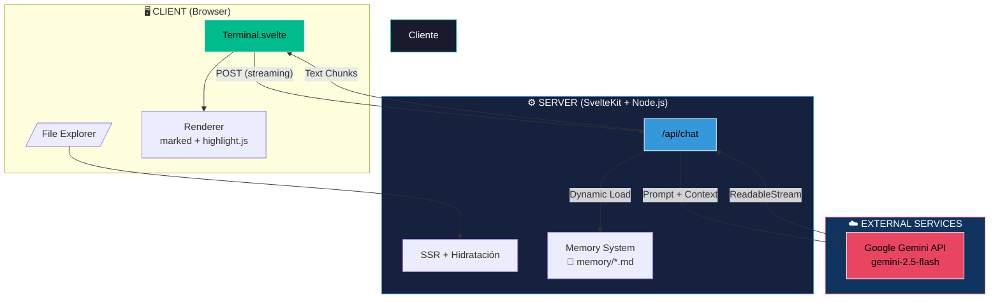
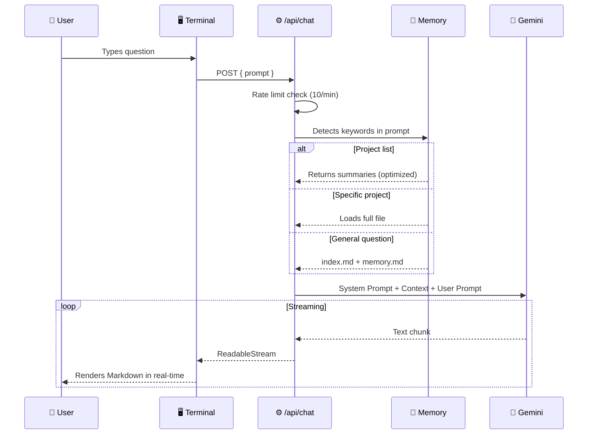

## 🏛️ System Architecture



### Data Flow



### Modular Memory System

```mermaid
flowchart TB
    subgraph Memory ["📁 src/lib/data/memory/"]
        index["index.md<br/>Professional Profile"]
        memory["memory.md<br/>Knowledge Base"]
        meta["meta.md<br/>Self-awareness"]
        projects["projects/*.md<br/>Project Docs"]
    end
    
    subgraph API ["⚙️ /api/chat"]
        keywords["Keyword Detector"]
        loader["Dynamic Loader"]
    end
    
    prompt["User Prompt"] --> keywords
    keywords -->|"all projects"| loader
    keywords -->|"print server"| loader
    keywords -->|"architecture"| loader
    
    loader -->|"Summaries"| projects
    loader -->|"Full File"| projects
    loader -->|"Meta"| meta
    loader -->|"Base"| index
    loader -->|"Base"| memory
    
    style Memory fill:#1a1a2e,stroke:#00bc8c,color:#fff
    style API fill:#16213e,stroke:#3498db,color:#fff
