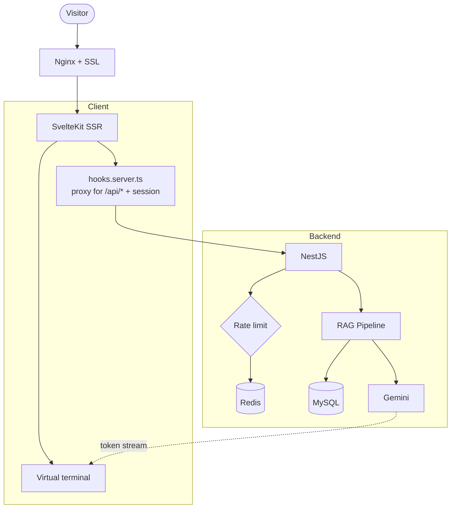
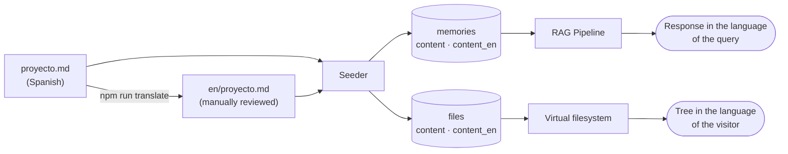

# Interactive Portfolio — Virtual terminal with hand-coded RAG

This site is the project. It's not a landing page with sections: it's a **virtual terminal** with its own filesystem that visitors navigate using `cd`, `ls`, `cat`, and `tree`, along with a conversational assistant that answers questions about my work using a custom-built **RAG (Retrieval Augmented Generation)** pipeline.

The technical premise lies in that last part. Today, tools like n8n and similar exist to solve AI workflows by dragging nodes: reading documents, extracting keywords, searching for relevant data, building the prompt, calling the model, returning the stream. Here, every single one of those steps is written in TypeScript, is inspectable, and runs inside the same app. It's not a visual pipeline: it's code I can debug, test, and explain line by line.

All content exists in **Spanish and English** without being written twice: it is drafted once, translated via a script that commits the output to the repo for review, and every layer—the filesystem, the RAG search engine, system parameters, page metadata—resolves the visitor's language, falling back to Spanish whenever a translation is missing.

## 📊 Architecture

**Stack:** SvelteKit with SSR (adapter-node) + NestJS + TypeORM + MySQL 8 + Redis, all running in Docker Compose behind Nginx with a Let's Encrypt certificate.

A design decision that pays off completely: **the client never communicates directly with the API**. `hooks.server.ts` intercepts all `/api/*` requests before SvelteKit resolves routes, strips the prefix, and proxies them to the backend, injecting the session's `Authorization` header. The browser never sees a token or the backend's internal URL, eliminating the need to configure CORS between them.

## 🧠 The RAG Pipeline, Step by Step

1. **Ingestion.** Each project is a `.md` file with frontmatter (`slug`, `title`, `summary`, `priority`, `techStack`, `keywords`). A seeder reads them and converts them into rows in the `memories` table.
2. **Keyword extraction.** If a document lacks keywords, it requests them from the LLM and persists them in `memory_keywords`. This is done once during ingestion, not per query: token costs are incurred at load time, not read time.
3. **Retrieval.** Upon receiving a query, relevant memories are searched by keywords and priority. Keywords co-exist in both languages on the same memory, as matching is done via substring against the query and is language-agnostic. Types (`META`, `INDEX`, `DOCS`, `PROJECT`) provide the retriever with a hierarchy: a profile carries a different weight than a specific project.
4. **Context assembly.** The prompt is assembled using the retrieved memories plus the active AI persona, resolving placeholders like `{{owner_name}}`, `{{social_github}}`, and others against the database configuration parameters on every request—in the visitor's language, if that key has a translation.
5. **Streaming.** Gemini's response is forwarded chunk by chunk to the terminal, which renders it with a typewriter effect.

None of this is hardcoded to my name: content comes from the database and identity comes from settings parameters, fully editable from the admin panel without touching code.

## 🌐 Bilingual Without Writing Twice

Translations **are not generated on the fly**: a script generates them, they are versioned in the repo, and I review them before publishing. A job-seeking portfolio cannot say something in English that its owner never read. What *is* automated is content uploaded via the admin panel: there, translation happens on save, as there is no commit step to review it.

Every translated column is optional. Without a translation, Spanish is served: the system is never blank, just less translated.

## 🗂️ The Virtual Filesystem

`~/proyectos/<slug>/README.md` files are not on disk: they are rows in the `folders` and `files` tables. A service synchronizes this structure from `PROJECT`-type memories, so **a single `.md` in the repo produces, in one run, an AI-queryable memory and a terminal-navigable folder**. A single source of truth for two distinct uses.

## Seeder Idempotency

**The Challenge:** Loading content appended data to index memories. Re-running the seeder—which happens on every deployment—duplicated every project in the profile, causing the RAG pipeline to read the exact same text three times, wasting context window and confusing the model.

**Defensive Resolution:**
- Generated sections are bounded by `<!-- projects:auto:start -->` / `<!-- projects:auto:end -->` markers and are fully **regenerated** instead of accumulated.
- Loading by slug performs an upsert: if the project exists, its content is updated and keywords are re-written from scratch.
- Result: the seeder is end-to-end idempotent and can be run on every deploy without second thoughts.

## Environment Variables in Docker

**The Challenge:** SvelteKit offers `$env/static/*`, which resolves variables at **build time**. Since Docker Compose injects them at runtime, the image was built with empty values, causing the app to start pointing nowhere without failing explicitly.

**Defensive Resolution:** Migrated to `$env/dynamic/*` for everything provided by the container. The exact same image serves development and production, and changing a variable requires a restart, not a rebuild.

## Rate Limiting Without Network Trust

**The Challenge:** The assistant consumes a paid API key, so the free tier is rate-limited by IP. However, behind a reverse proxy, the app sees the proxy's IP instead of the visitor's: without proper headers, all queries fall into the same bucket, and the first user drains the entire limit.

**Defensive Resolution:**
- Nginx forwards `X-Real-IP` and `X-Forwarded-For`, allowing the API to resolve the true IP from them.
- The counter resides in Redis with a 24h TTL, backed by an in-memory fallback if Redis fails to respond: a cache outage shouldn't crash the chat.
- When the quota is exhausted, it doesn't fail with a blunt error: it responds with my contact info fetched from the system settings. The limit acts as an invitation to reach out, not a brick wall.

## A Portfolio Google Couldn't Read

**The Challenge:** The site features SSR, but settings and the file tree were fetched in `onMount`—meaning in the browser. The server-rendered HTML contained **202 text characters**, all from the UI ("Seleccioná un archivo para comenzar"), the page title read the default `Developer - Portfolio`, and my name appeared nowhere. An engineer opening the site saw a terminal; Google opening the site saw nothing.

**Defensive Resolution:** The server-side `load` fetches system parameters and the file tree before rendering, the markdown viewer parses within the component body instead of an effect—since effects don't run on the server—and the initial view is selected during initialization, not afterwards. Same design, same visitor experience: HTML size grew from 6 KB to 56 KB and from 202 to 1,700 characters of real text, complete with my name and role in the `<title>`, `Person` structured data, and OpenGraph images for social sharing.

## The Translator That Invented Tech Stacks

**The Challenge:** The initial translation tool sent the entire file to Gemini, frontmatter included. When processing a document that **lacked** frontmatter, the model invented a complete one: a `techStack` featuring React, PostgreSQL, and AWS—technologies I don't use, posted on my professional profile in English. In another document, it spontaneously converted ASCII art diagrams into `mermaid` blocks with syntax errors.

**Defensive Resolution:** Frontmatter bypasses the model entirely. It is extracted beforehand, copied byte-for-byte, and only the title and summary are substituted after being translated separately as plain text. Furthermore, the script compares code block sequences between original and translation, throwing an alert on mismatch. The key rule remains: **give the model prose and ask for prose**; handle all structural tasks strictly in code.

## The Late Dictionary

**The Challenge:** Switching the site to English broke it. The browser console threw `Cannot format a message without first setting the initial locale` upon entry and again on reload. Translation dictionaries load via dynamic `import()`, so locale starts at `null` until download completes; meanwhile, six terminal commands requested translated text **at the module root**, right as the JS chunk loaded. Sometimes the download won the race, sometimes the import did.

**Defensive Resolution:** Descriptions were converted into getters—evaluated when accessed, not when the file is imported—the layout's `load` function awaits the dictionary prior to first render, and initialization was consolidated into a single place instead of two competing calls. As a bonus, languages now switch on the fly: previously, they remained frozen in whichever locale existed at import time.

## Quotas Are Per-Model, Not Global

**The Challenge:** The AI provider's free tier allows a low daily limit **per model**. Batch-translating documentation using the exact model serving visitors exhausts the assistant's quota, and visitors hit the wall before you notice.

**Defensive Resolution:** The assistant iterates through a chain of models—when one reports "quota exceeded", it fails over to the next, each maintaining its own count—while all batch translation tasks strictly use a model outside that fallback chain. On quota exhaustion, it avoids retries: retrying against a daily rate limit is pure log noise.

## Pruning the Surplus

**The Challenge:** The project originally started as a multi-tenant white-label platform: per-user subdomains, public registration, and every user having their own portfolio and API keys. All that machinery—registration, email verification, subdomain resolution, third-party keys—worked fine. But nobody needed it: it's *my* portfolio.

**Defensive Resolution:**
- Removed public registration; the owner account is created via seeder, with environment variables as the single source of truth for credentials.
- Completely scrapped "bring your own API key": the key belongs to the server and rate limits are applied per IP.
- Admin access was relegated to a terminal command intentionally omitted from help listings, prompting for a password with masked input so it isn't saved in browser command history.
- User scoping in queries was left intact: removing it would require a massive refactoring with zero practical gain. Pruning isn't razing.

Recognizing over-engineering and stepping back is an engineering decision like any other. I share it because it's the part of the project that taught me the most.
