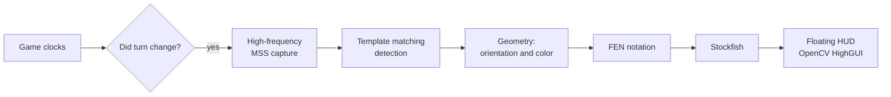

# Søren Mirror (chess overlay)

A desktop overlay that watches an on-screen chess game, reconstructs the position, and displays Stockfish analysis in a floating HUD, in real time.

The design-defining constraint: **no code is injected into the browser, and the DOM is not read**. Only pixels. This makes it platform-independent—working just the same with any chess site or a board in a video—at the cost of having to manually resolve things the DOM would readily provide: where the board is, what color you are playing, and whose turn it is.

It is the same approach as SØREN: perceiving through vision instead of coupling to the internals of an external program.

## 📊 From pixels to FEN

## The board does not always face the same way

**The Challenge:** the same board, played as black, is flipped. If the bottom row is assumed to be white, the reconstructed position is coherent, plausible, and **completely wrong**: a valid FEN is generated for a game that does not exist, and Stockfish confidently analyzes something that is not happening. It is the worst kind of error: silent and convincing.

**The Defensive Resolution:**
- The player's color is automatically detected, and the board geometry is adjusted before generating the FEN.
- The integrity of the position is validated: if the detected layout is not a plausible board, no analysis is output instead of outputting a fabricated one.
- When in doubt, **stay silent**. A missing analysis is an issue; a false one is a trap.

## Calibrating instead of hardcoding

**The Challenge:** the board coordinates depend on the resolution, zoom, website, and how each user has their window set up. Any constant in the code only works on the machine where it was written.

**The Defensive Resolution:** a separate tool (`get_coords.py`) allows marking regions interactively on the actual screen, and the configuration lives separately from the logic (`src/config.py`). Adapting it to another monitor or platform is a matter of recalibrating, not editing code.

## Detecting the turn via the clock

**The Challenge:** analyzing every frame is expensive and redundant: the position only changes when someone moves. But asking the board "did you change?" is exactly the difficult problem we are trying to solve.

**The Defensive Resolution:** the game clocks are monitored with millisecond precision. The clock is a cheap signal to read and is unambiguous—when the active clock switches sides, a move has occurred. The analysis is triggered by this event instead of a blind loop.
