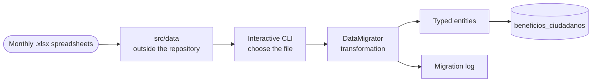

# Fortalecimiento Migration

Every month, an updated registry of social program beneficiaries arrives in Excel spreadsheets, and it must be reflected in the municipality's `beneficios_ciudadanos` table. This Node.js tool performs that migration.

Put that way, it sounds like a one-afternoon script. What makes it a project is the context: **it is recurring, the data is personal, and the outcome changes someone's life**. If a run duplicates records or overwrites the registry with the wrong spreadsheet, the consequence is not a bug in a dashboard: it is a person who goes to collect their benefits and cannot.

## 📊 Flow

## 🧩 Structure

Separation by responsibility, not convenience: database connection layer, domain entities (the migration log and the citizen benefit separately), transformation logic concentrated in `DataMigrator`, and an `index` that only orchestrates. Spreadsheets are organized into subdirectories by type (`formatted`, `fortalecimiento`) and the CLI makes you choose which one to run, instead of assuming.

## Data Does Not Enter the Repository

**The Challenge:** the input of the process is a list of real people with their data. In a project where spreadsheets live alongside the code, sooner or later one ends up in a commit — and once it enters the git history, removing it is surgery.

**The Defensive Resolution:**
- `src/data` is excluded from the repository by design, and is not versioned, not even with an example `.gitkeep` that invites filling it.
- Whoever clones has to **create the structure manually**. It is deliberate friction: it forces you to think about where the data goes before having a place to put it.
- The repository remains portable —it can be shared, reviewed, or published— without dragging along anyone's personal information.

## Choose, Don't Guess

**The Challenge:** a monthly process that runs solely on "whatever file is in the folder" is a ticking time bomb: it only takes leaving last month's spreadsheet there to silently reprocess it.

**The Defensive Resolution:** the interface is an interactive CLI where you explicitly choose which file is migrated. A manual step, on purpose, at the only point in the process where making a mistake is costly.
