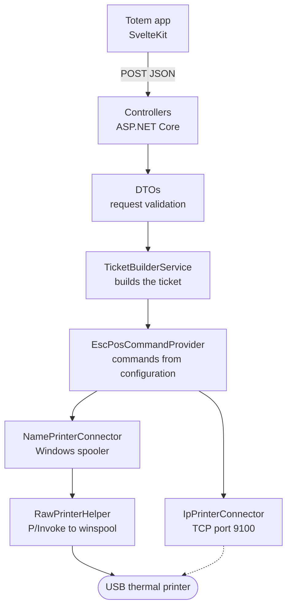

# Print Server — printing from a browser

It's the **VUS** component that turns a queue ticket into a piece of paper. A .NET 8 microservice that runs on the same machine as the kiosk, listens for HTTP on localhost, and translates JSON into the ESC/POS commands a thermal printer understands.

It lives in its own repository, in its own language, and with its own deployment cycle: the rest of VUS is TypeScript on Kubernetes, while this is C# on a Windows MiniPC tucked inside a cabinet. They are two different worlds, and that is precisely the reason it exists as a separate service.

## 📊 The layers

The dotted path exists in the code but is not used: the kiosk in production prints by name, against the spooler. It is written anyway because a network printer is the scenario for the day when there is more than one kiosk per building.

## 🧩 Two ways to talk to a printer

| Mode | How | When it is useful |
|---|---|---|
| By name | Windows Spooler (`winspool.drv`) via P/Invoke, RAW bytes | Printer connected via USB to the same machine |
| By IP | Direct TCP socket to port 9100 | Network printer, shared between terminals |

The difference is not cosmetic: by name, you inherit the queue, permissions, and operating system driver; by IP, you bypass them all and are left with just the protocol. Each has its own paper-cutting method—perforated in one, full cut in the other—and that kind of detail is what makes a ticket print correctly or come out cut in half.

## The browser does not talk to the USB port

**The Challenge:** connecting a modern browser to a USB thermal printer involves experimental APIs or extensions. Both break on their own with the next browser update, and the one who finds out is the citizen standing in front of the kiosk.

**The Defensive Resolution:** a local daemon. The frontend sends a clean JSON and knows nothing about hardware; the daemon takes care of the driver, the protocol, and the queue. If the printer changes tomorrow, only one component changes, and no frontend ever knows.

## The ñ does not exist

**The Challenge:** a thermal printer does not speak UTF-8. It speaks whatever *code page* it has configured, and in a ticket with real first and last names, that means the ñ and accents come out as gibberish.

**The Defensive Resolution:** explicitly register the .NET provider for additional encodings and build the ticket against the printer's code page, not the process's. This is a problem that does not appear in development—where everything is ASCII and test names—and shows up on the first day of production, with the first last name containing an eñe.

## A service that prints needs the permissions of the user who prints

**The Challenge:** the executable printed perfectly when launched manually and failed with `Access denied` when running as a Windows service. The service account was not the same as the one that had the printer installed.

**The Defensive Resolution:** treat the service identity as part of the deployment and not as an operating system detail. An unattended service runs under its own user, and everything it touches—printers, paths, configuration files next to the executable—must be permitted for *that* user, not the one who performed the installation.

## ESC/POS commands are parameters, not code

**The Challenge:** bold, centering, paper cutting, and drawer opening are byte sequences that vary between printer brands. Hardcoding them ties the binary to a specific model.

**The Defensive Resolution:** the commands live in the configuration, not in the code. Changing the printer means editing a file and restarting the service, not recompiling and redeploying. It is the same decision as in the rest of VUS: what changes based on the institution is data.

## Deploying to a machine that is not a server

**The Challenge:** the target is not a Linux server with SSH access and an installed runtime: it is a Windows MiniPC, inside a kiosk, in a building with public service. Installing dependencies manually does not scale even to two terminals.

**The Defensive Resolution:** *self-contained* publishing—the executable carries its own runtime, the target machine does not need to have .NET installed—and a GitLab pipeline that compiles on every push but **deploys only when someone presses the button**, and only from `main`. Compilation is automatic because making a mistake there is free; deployment is manual because on the other side, there are people waiting to get a ticket.

---

## 📌 Note

It is part of the VUS ecosystem: the kiosk requests the ticket, and it prints it. The code lives in an internal GitLab of the municipality, not in a public repository. What is documented here is the architecture and technical decisions, not a copy of the code.
