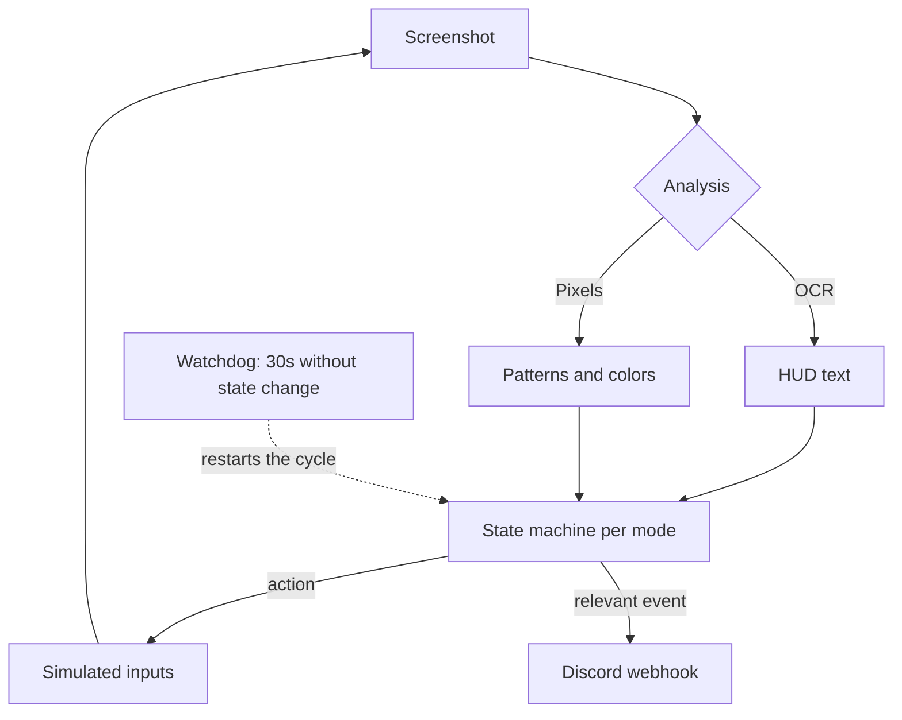

# SØREN

`SØREN` (repo: `pizzan-t`) is a Python side project that automates a repetitive task within a game: detecting rare encounters on screen and reacting. I include it in my portfolio not because of the domain—it's a game—but because of the engineering problem, which is the same one found in a municipal kiosk or a waiting room screen: **a process that runs for hours unattended and cannot afford to hang**.

The core design decision: do not touch the memory of the external process or intercept its packets. It reads what is visible—OCR and pixel analysis on the window—and acts using standard inputs. It is more difficult than reading memory, but it does not rely on the internal structure of a program I do not control: when a new version is released, only the visual recognition breaks, not everything.

## 📊 Perception and Action Cycle

## 🧩 Modular Architecture

Each operating mode (hordes, ditto, single) is its own state machine, with its own separate logic. Previously, it was a single flow with nested conditionals trying to cover all three, and every fix in one broke another. Separating them allowed each mode to be stabilized independently.

What is common to all: scanning the entire field. An optimized mode that only looked where the important elements "should" appear would miss rare cases, which are precisely the ones that matter.

## The Watchdog

**The Challenge:** a perception-action cycle can get stuck in ways that cannot be enumerated beforehand: an unexpected dialog box, a longer animation, the window losing focus. The process remains alive but makes no progress, and since it doesn't crash, nothing alerts you. You would find out three hours later that it had been stalled since minute twenty.

**The Defensive Resolution:**
- An independent watchdog monitors the progress of the state machine. If 30 seconds pass without a transition, it assumes it is stuck and forces recovery.
- Detection is based on **lack of progress**, not a list of known errors: this covers failure modes I haven't even seen yet.
- It is the same concept I apply to 24/7 systems: never trust things to fail loudly.

## Observability of What You Aren't Watching

**The Challenge:** if the value of the process is running unattended, you cannot find out what it did by watching it.

**The Defensive Resolution:**
- Structured logging with millisecond timestamps and state metrics, to allow reconstructing what happened and when.
- Notifications via Discord webhook for every relevant event: the process reaches out to you, not the other way around.
- A minimal control panel to start, stop, and switch modes without touching the code.

## Timing That Isn't a Metronome

**The Challenge:** a loop that acts exactly every N milliseconds is trivially distinguishable from a human, and it is also fragile: it assumes the world always responds in the same amount of time.

**The Defensive Resolution:** variable timing with micro-pauses and a concept of "fatigue" that degrades the pace over time. The useful side effect is robustness: by not assuming fixed times, it better tolerates slow system responses.
