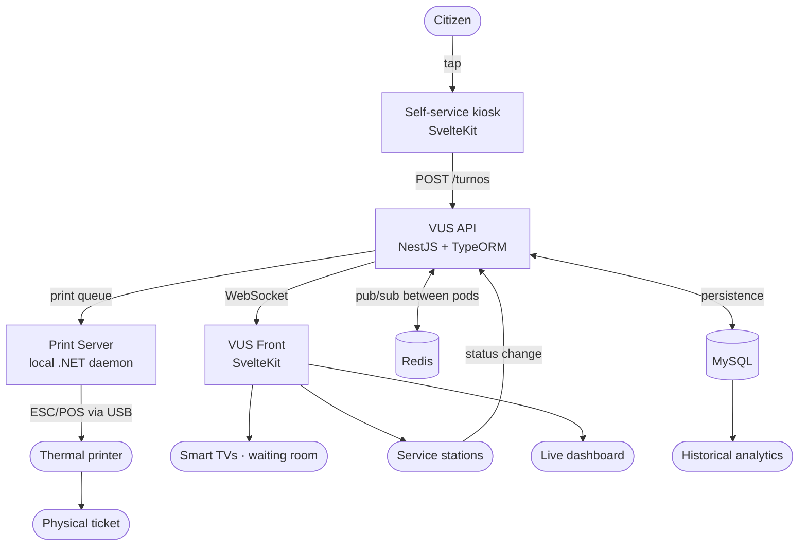
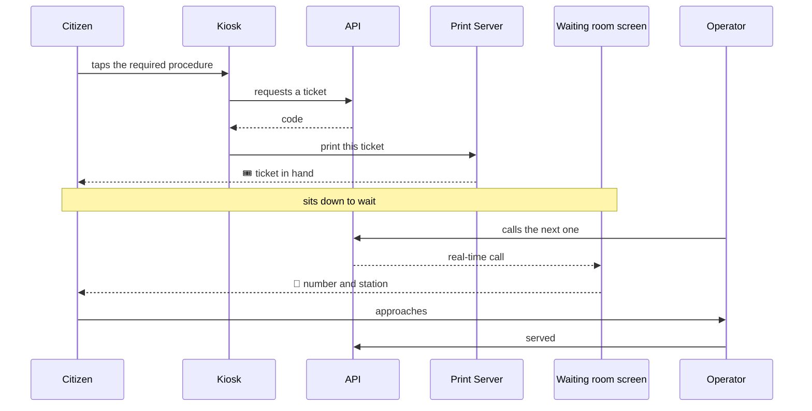
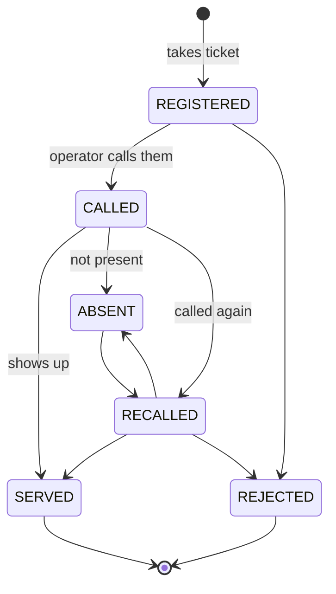

# VUS — Queue Management System

It's a **queue-calling system**: the software that puts a public-facing building's queue in order. The citizen arrives, takes a ticket at a touch-screen terminal, and sits down; a screen calls them by number and station; an operator serves them from their station and closes the ticket. In the Municipality of Ituzaingó, it is known as **VUS (Ventanilla Única Simplificada)**, but the institutional name describes the policy, not the software: technically, it is a real-time queue management system.

What makes it interesting is not the domain —a ticket dispenser is conceptually simple— but the conditions: it runs all day, with heterogeneous hardware, real people waiting, and no one watching the logs. Each component fails differently, and all of them must degrade gracefully without bringing down the rest.

## 📊 Architecture

## 🎫 The journey of a ticket

The entire system exists to ensure this sequence is never interrupted at any point. Each arrow represents a different component, with a different way of failing.

## 🧩 The components

- **Kiosk** (SvelteKit) — self-service touch terminal. One tap, one ticket, one printed slip.
- **API** (NestJS + TypeORM + MySQL) — the engine: offices, tickets, status auditing, and WebSocket broadcasting.
- **Front** (SvelteKit + adapter-node) — the waiting room TVs and the operator panel, served by Node with SSR and form actions. The session lives in `httpOnly` cookies; the server hook decodes the JWT, renews it only when expired, and retries once any request that encountered a 401, so the operator's session isn't cut short mid-ticket due to an expired token.
- **Integrations** — the system does not own all of its data: users and permissions come from the municipality's central authentication service, and the citizen registry comes from a catalog service. VUS references, it does not copy.
- **Dashboard** (Chart.js) — the snapshot of the moment: what is happening **now** in the building. It feeds on the same socket events as the screens, so it updates automatically.
- **Analytics** (Chart.js) — the opposite of the dashboard: historical queries on already closed data. Service times, volume per office, behavior by time slot.
- **Print Server** (.NET / C#) — local daemon that translates HTTP/JSON into native ESC/POS commands. It has its own documentation: `cat ~/proyectos/print-server/README.md`.
- **Configuration** — offices, services, and caller behavior are configured from within the system, without touching code or redeploying. What changes depending on the institution is data, not the build.
- **Infrastructure** — Kubernetes with multiple pods, Redis, MySQL, and CI/CD in GitLab.

## 🔁 The lifecycle of a ticket

A ticket is born **registered** in an office's queue, moves to **called** when an operator claims it to their station, can be **recalled** as many times as necessary, and ends up **served**. If they never show up, it is marked as **absent**.

Alongside this operational status runs a second axis, the **resolution**: whether the ticket is open, closed, or **referred** to another office. These are two separate axes because they answer different questions —"what is happening to the citizen right now?" and "is this procedure finished?"— and confusing them was the source of half the bugs that had to be fixed.

Referral is the interesting case: when a procedure starts in one office and continues in another, the original ticket is closed as referred, and a new queue entry is born in the destination office, pointing to the original one. One citizen, one journey, two traceable queue entries.

The dashboard and analytics share the graphing library but not the same problem: one must react in milliseconds to an event, while the other must aggregate months of records without bringing down the database. Mixing them into a single "do-it-all" view would have resulted in heavy queries running in real time.

---

## The query that brought down the API

**The Challenge:** The system collapsed with a `TIMEOUT_ERROR` right when generating the first call of the day. The concurrency of historical inserts clashed with full reads because the query used `DATE(createdAt) = CURDATE()`. Wrapping the column in a function negates the index and forces a Full Table Scan — precisely during the morning transactional peak.

**The Defensive Resolution:**
- The data layer was rewritten using pure ranges: `createdAt >= CURDATE() AND createdAt < CURDATE() + INTERVAL 1 DAY`.
- By making the query **SARGable**, MySQL applies the index and resolves in milliseconds what previously brought down the API.
- Statuses were separated in the Socket.IO channel so that the ephemeral TCP connection has no friction with the JWT lifecycle.

## The call that got lost between pods

**The Challenge:** Upon moving to Kubernetes with multiple replicas, calls began to fail intermittently and bafflingly: a ticket was called, and **some screens never found out**. It wasn't an error, there was no exception, and there was nothing in the logs.

The cause: Socket.IO keeps connections in process memory. With a single pod, that is enough. With multiple pods, each one only knows about the clients connected to it. When an operator called a ticket and their request hit pod A, the event was emitted only to A's clients — screens connected to pod B were left waiting for something that would never arrive. And since the load balancer distributes traffic, which screen saw which call was left to chance.

**The Defensive Resolution:**
- **Redis was added as a pub/sub channel between pods**: each instance publishes its events and subscribes to those of the rest, so emitting from any pod reaches all clients, regardless of where they are connected.
- Connection state no longer lives solely in the memory of a single process: pods become truly interchangeable, which is the premise Kubernetes assumes and the code was failing to meet.
- This is the underlying lesson: **horizontal scaling is not just about spinning up more replicas**. Everything implicitly held in memory —connections, sessions, cache— must be externalized first, or the system will start working only "sometimes."

With three replicas, there is a **second** way to break, independent of the first, and Redis does not fix it: before the WebSocket is established, Socket.IO negotiates the connection with several HTTP requests that must **all hit the same replica**. With the load balancer distributing traffic, the second request hits a pod that knows nothing about the first, and the connection fails intermittently, with no pattern.

The textbook solution was to ask the networking team for session affinity on the load balancer. The approach I took does not depend on anyone: **the client connects directly via WebSocket, bypassing HTTP negotiation entirely**. Before removing it, I verified that in practice it was already choosing WebSocket anyway — meaning that "fallback" was not a safety net, but the sole source of the problem.

And a decision I stand by: if Redis does not respond or the URL is incorrect, **the API still starts up** and warns in the log. Previously, it didn't: a typo in an environment variable would prevent all three replicas from starting. A dashboard missing a call is noticed and investigated; three down replicas means there is no system. The trade-off is that it degrades silently, so the startup log explicitly states whether the inter-pod channel was activated: it is the only signal available.

## Screens that live forever

**The Challenge:** Waiting room screens are never turned off. They accumulated ticket markers in an unbounded `Set` —a slow but certain leak— and had custom watchdogs forcing WebSocket reconnections every 10 seconds, fighting against the library's natural lifecycle. Side effect: the audio for the same call was triggered multiple times.

**The Defensive Resolution:**
1. **Bounded LRU:** The infinite `Set` became a `Map` that auto-deletes records older than 60 seconds. The RAM footprint remains flat for life.
2. **Armored Debounce:** Absolute `ID + Estado` hash with a 15-second anti-repetition window, which blocks concurrent and identical socket events.
3. **Layered Resilience:** The screen is the only part of the system that no one monitors. If its connection drops, it attempts to reconnect on its own every ten seconds; and in case that also fails, every thirty seconds it requests the data again via HTTP as if real-time did not exist. No one has to climb a ladder to restart a TV.

## A kiosk doesn't wait for a click

**The Challenge:** Upon dispensing the ticket, a success modal blocked the screen with "Press OK". If the citizen grabbed their ticket and walked away —which is exactly what everyone does— the terminal remained stuck for the next person.

**The Defensive Resolution:** Blocking modals were removed from the success flow. The kiosk dispatches the ticket to the print queue and automatically returns to the welcome screen, with no intermediate steps. The default state of a kiosk must be "ready for the next one."

## The ticket that was born dead

**The Challenge:** Referred tickets arrived in red at the destination office. The clone generated by the referral was born with status `1`, which in the system's dictionary is not "new": it is **NO-SHOW**. The citizen was standing waiting at the Treasury, and their ticket appeared as if they had never shown up.

**The Defensive Resolution:** The status dictionary became explicit and shared between the backend and frontend, and the referral is born with the status corresponding to "in queue". The bug was not one of logic but of vocabulary: two layers using the same number to mean different things.

## A history that lied

**The Challenge:** Every time an operator recalled a citizen, the ticket history saved `*"RESOLUCIÓN CONCLUIDA - ENTRADA CERRADA"*`. This condition confused the **recalled** status with a closure, so the audit log was filled with completions that never occurred.

**The Defensive Resolution:** History texts are derived from the actual status, and both the call and recall also save which station was called. Along the way, a sister problem was found: the referral called the generic update method, which logged its own progress, leaving two entries in the history for each referral. We now write directly to the repository when the side effect is not applicable.

## The bell that rang too often

**The Challenge:** Waiting room screens play a chime when someone is called. Administratively closing a ticket whose last operational status had been "called" re-emitted that status, and the room heard the chime for someone who was not actually being called. People were getting up from their seats due to a spreadsheet closure.

**The Defensive Resolution:** The event was split into two. One is dispatched when the operational status changes —and that is the only one the TVs listen to— and another when only the administrative resolution changes, which the operator panels listen to. Public signage stopped finding out about things that do not concern it.

There was a second, more subtle cause for the same symptom: reopening a ticket saved the status change first and then the note in the history. Since the event is dispatched with the status change, the screen would read the ticket **before** the note telling it "this is a reopening, do not chime" existed. The order was reversed: note first, status second. In an operation that triggers an event, the order in which you write is not a style detail — it determines what the listener sees.

## Counting referrals when the data is ambiguous

**The Challenge:** Referring and reopening a ticket left exactly the same mark on the resolution. Counting referrals by reading that field mixed the two, inflating the daily metrics.

**The Defensive Resolution:** A referral is counted by the only thing that defines it unambiguously: the new queue entry pointing to its source ticket. The metric stopped depending on a status that can change later and started depending on an event that already occurred.

## The operator's name does not live in this database

**The Challenge:** The stations table stored the operator's name and employee ID, copied from the municipality's central authentication system. As soon as someone updated their details there, the old version remained here, and another person's name appeared on the station's screen.

**The Defensive Resolution:** The station stores only the reference to the user; the name is resolved against the service that owns that data. A single source of truth, even if it costs an extra query. Data from another system is referenced, not copied.

## The real-time connection that turned itself off

**The Challenge:** Screens and panels stopped updating without any error, intermittently, with no pattern. These were **three distinct problems** producing the exact same symptom:

1. The connection was shared across the entire application, but each screen opened it upon entering and **closed it upon leaving**. An operator moving from their station to serve a ticket turned off real-time for everyone, and nothing turned it back on.
2. The waiting room screen has no logged-in user. When it received a notification and tried to reload its data, the HTTP client —designed for screens with an active session— redirected it to the login page. The notification arrived, but the data was never reloaded.
3. The kiosk notified of each new ticket, but the server **had no listener declared for that notification**. Socket.IO silently discards what no one is declared to receive: the message was sent, arrived, and was thrown away.

**The Defensive Resolution:** The connection became owned by the layout rather than each individual screen —it is opened once and lives as long as the application lives—, the public read path was separated from the one requiring a session, and the server was configured to explicitly retransmit what clients send. The underlying lesson is the first one: **real-time doesn't tell you when it breaks**. You have to look for it, because it won't show up in any log.

## Three seconds and I'm out

**The Challenge:** The internal network of a municipal building suffers from micro-outages. A request to the backend that was left waiting forever hung the operator's screen —not slow: hung— because no one on the other side was going to respond or close the connection.

**The Defensive Resolution:** Every request is aborted after three seconds and returns an error that the interface knows how to display. Additionally, the login clears old cookies upon entry, because a half-dead previous session caused the login to fail without explanation, and disables the button while waiting, preventing a network delay from turning into three simultaneous login attempts. A three-second error is preferable to a screen that never recovers.

## The monorepo that wasn't

**The Challenge:** The four microservices lived inside a single shared `.git`. It wasn't a monorepo with monorepo tools: it was just a large folder. Dependency collisions, overlapping scripts, and a CI/CD pipeline that didn't know what it was building.

**The Defensive Resolution:** Each service was split into its own repository with an independent lifecycle, and the CI was pointed to the municipality's internal infrastructure.

## Mixed content and environments

**The Challenge:** In production, *mixed content* errors appeared: frontends served over HTTPS trying to talk to hardcoded HTTP endpoints.

**The Defensive Resolution:** Dynamic protocol injection. Frontends read `window.location.protocol` and automatically upgrade to `https://` and `wss://` when the proxy provides certificates, without touching Vite's environment layer and without duplicating builds per environment.

---

## 📌 Note

The most recent version of the code lives in an internal GitLab of the municipality, not in a public repository. What is documented here reflects the architecture and technical decisions, not a copy of the current code.
