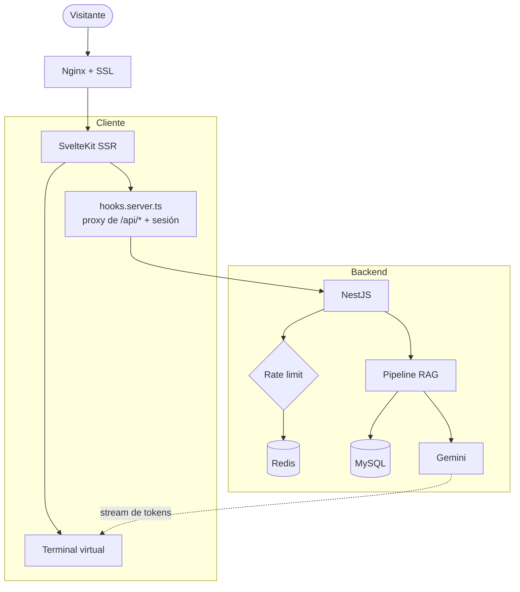
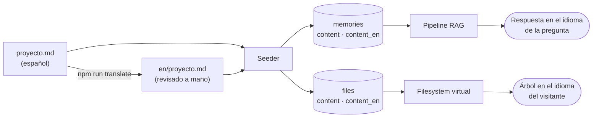

# Portfolio interactivo — Terminal virtual con RAG escrito a mano

Este sitio es el proyecto. No es una landing con secciones: es una **terminal virtual** con un filesystem propio que el visitante navega con `cd`, `ls`, `cat` y `tree`, y un asistente conversacional que responde sobre mi trabajo usando un pipeline **RAG (Retrieval Augmented Generation)** construido a mano.

## No es un chatbot sobre mis archivos: es un sistema parametrizable

**El desafío:** un portfolio se desactualiza el día que lo publicás. Cambiar un rol, corregir una bio, ajustar cómo responde el asistente — si cada cambio es un commit y un deploy, no lo hacés. Y si el sistema alguna vez tiene que servir a otra persona, tener el contenido hardcodeado lo vuelve imposible.

**La resolución:** todo lo que se ve y todo lo que el asistente sabe es dato, no código. Un panel de administración gobierna tres capas:

- **Parametría.** Identidad, branding, SEO, el prompt de la terminal y hasta el nombre del comando del asistente viven en la base de datos. No hay una sola cadena con mi identidad en el código: el sitio es *white-label* por diseño (GPL-3.0), y la misma instancia puede servir otro portfolio, con otro dominio, sin tocar una línea.
- **Contenido y recuperación.** Los proyectos se cargan como Markdown y se sincronizan al filesystem virtual que el visitante navega. Cada uno lleva un set de **keywords curadas a mano** que es lo que alimenta la recuperación del RAG: el índice es contenido editable, no un embedding opaco. Si el asistente responde mal sobre un proyecto, se corrige editando datos, no reentrenando nada. El CV vive por idioma, con fallback si falta uno.
- **Comportamiento del asistente.** Las personalidades son datos: modos con prompt fijo definidos en código, y personalidades editables con su propio `systemPrompt`, estilo de voz, idioma (`es-AR`, no "español neutro") y saludo propio. Cambiar cómo suena el asistente es configuración, no deploy.

**La consecuencia:** un cambio de contenido, de idioma o de personalidad no pasa por CI/CD. El pipeline RAG está escrito a mano —esa es la otra mitad del argumento—, pero lo que lo vuelve mantenible es que todo lo que consume es administrable.

## El pipeline RAG, escrito a mano

La tesis técnica es esa última parte. Hoy existen herramientas —n8n y compañía— que resuelven un flujo de IA arrastrando nodos: leer documentos, sacar keywords, buscar lo relevante, armar el prompt, llamar al modelo, devolver el stream. Acá cada uno de esos pasos está escrito en TypeScript, es inspeccionable y corre dentro de la misma app. No es un pipeline visual: es código que puedo debuggear, testear y explicar línea por línea.

Todo el contenido existe en **español e inglés** sin escribirse dos veces: se redacta una vez, se traduce con un script que deja el resultado en el repo para revisarlo, y cada capa —el filesystem, el buscador del RAG, la parametría, los metadatos de la página— resuelve el idioma del visitante y cae al español cuando falta una traducción.

## 📊 Arquitectura

**Stack:** SvelteKit con SSR (adapter-node) + NestJS + TypeORM + MySQL 8 + Redis, todo en Docker Compose detrás de Nginx con certificado de Let's Encrypt.

Una decisión de diseño que se paga sola: **el cliente no habla directo con la API**. `hooks.server.ts` intercepta todo `/api/*` antes de que SvelteKit resuelva rutas, le saca el prefijo y lo proxea al backend inyectando el `Authorization` de la sesión. El browser nunca ve un token ni la URL interna del backend, y no hay que configurar CORS entre ambos.

## 🧠 El pipeline RAG, paso por paso

1. **Ingesta.** Cada proyecto es un `.md` con frontmatter (`slug`, `title`, `summary`, `priority`, `techStack`, `keywords`). Un seeder los lee y los convierte en filas de la tabla `memories`.
2. **Extracción de keywords.** Si un documento no trae keywords, se las pide al LLM y las persiste en `memory_keywords`. Se hace una vez, en la ingesta, no en cada consulta: el costo de tokens es de carga, no de lectura.
3. **Recuperación.** Ante una pregunta, se buscan las memorias relevantes por keywords y prioridad. Las keywords conviven en los dos idiomas sobre la misma memoria, porque el match es por subcadena contra la pregunta y no tiene idioma propio. Los tipos (`META`, `INDEX`, `DOCS`, `PROJECT`) le dan al recuperador una jerarquía: el perfil pesa distinto que un proyecto puntual.
4. **Armado de contexto.** Se compone el prompt con las memorias recuperadas más la personalidad de IA activa, y se resuelven los placeholders `{{owner_name}}`, `{{social_github}}` y demás contra la parametría en base de datos, en cada request — en el idioma del visitante, si esa clave tiene traducción.
5. **Streaming.** La respuesta de Gemini se reenvía chunk a chunk hasta la terminal, que la va escribiendo con efecto typewriter.

Nada de esto está hardcodeado a mi nombre: el contenido sale de la base y la identidad sale de la parametría, editable desde el panel sin tocar código.

## 🌐 Bilingüe sin escribir dos veces

Las traducciones **no se generan en vivo**: un script las produce, quedan versionadas en el repo y yo las leo antes de publicarlas. Un portfolio en búsqueda laboral no puede decir en inglés algo que su dueño nunca leyó. Lo que sí es automático es lo que se carga desde el panel: ahí la traducción se hace al guardar, porque no hay un commit de por medio donde revisarla.

Cada columna traducida es opcional. Sin traducción, se sirve el español: el sistema nunca queda vacío, sólo menos traducido.

## 🗂️ El filesystem virtual

`~/proyectos/<slug>/README.md` no son archivos en disco: son filas en las tablas `folders` y `files`. Un servicio sincroniza esa estructura desde las memorias tipo `PROJECT`, así que **un `.md` en el repo produce, en una sola corrida, una memoria consultable por la IA y una carpeta navegable en la terminal**. Una sola fuente de verdad para dos consumos distintos.

## Idempotencia del seeder

**El Desafío:** la carga de contenido appendeaba a las memorias índice. Correr el seeder de nuevo —cosa que pasa en cada deploy— duplicaba cada proyecto en el perfil, y el RAG terminaba leyendo el mismo texto tres veces, gastando contexto y confundiendo al modelo.

**La Resolución Defensiva:**
- Las secciones generadas se delimitan con marcadores `<!-- projects:auto:start -->` / `<!-- projects:auto:end -->` y se **regeneran** completas, en vez de acumularse.
- La carga por slug hace upsert: si el proyecto existe se actualiza el contenido y se regraban las keywords desde cero.
- Resultado: el seeder es idempotente de punta a punta y se puede correr en cada deploy sin pensarlo.

## Variables de entorno en Docker

**El Desafío:** SvelteKit ofrece `$env/static/*`, que resuelve las variables **en tiempo de build**. Como Docker Compose las inyecta en runtime, la imagen se construía con los valores vacíos y la app arrancaba apuntando a ninguna parte, sin fallar de forma obvia.

**La Resolución Defensiva:** migrar a `$env/dynamic/*` en todo lo que provee el contenedor. La misma imagen sirve para desarrollo y producción, y cambiar una variable es reiniciar, no reconstruir.

## Rate limiting sin confiar en la red

**El Desafío:** el asistente consume una API key de pago, así que el free tier se limita por IP. Pero detrás de un proxy inverso, la aplicación ve la IP del proxy, no la del visitante: sin las cabeceras correctas, todas las consultas caen en el mismo balde y el primero que llega se lo come entero.

**La Resolución Defensiva:**
- Nginx propaga `X-Real-IP` y `X-Forwarded-For`, y la API resuelve la IP real desde ahí.
- El contador vive en Redis con TTL de 24h, y hay fallback en memoria si Redis no responde: que se caiga el cache no puede tirar el chat.
- Al agotarse el cupo no se corta con un error seco: se responde con mis datos de contacto, leídos de la parametría. El límite es una invitación a escribirme, no una pared.

## Un portfolio que Google no podía leer

**El Desafío:** el sitio tiene SSR, pero la parametría y el árbol de archivos se pedían en `onMount`, o sea ya en el navegador. El HTML que salía del servidor tenía **202 caracteres de texto**, todos de la interfaz —"Seleccioná un archivo para comenzar"—, el título decía `Developer - Portfolio` con el valor por defecto, y mi nombre no aparecía en ninguna parte. Un ingeniero abría el sitio y veía una terminal; Google abría el sitio y no veía nada.

**La Resolución Defensiva:** el `load` del servidor trae la parametría y el árbol antes de renderizar, el visor de markdown parsea en el cuerpo del componente en vez de en un efecto —los efectos no corren en el servidor— y la portada se elige en la inicialización, no después. Mismo diseño, mismo comportamiento para el visitante: el HTML pasó de 6 KB a 56 KB y de 202 a 1.700 caracteres de texto real, con el nombre y el rol en el `<title>`, datos estructurados de tipo `Person` y la imagen para cuando alguien comparte el link.

## El traductor que inventaba tecnologías

**El Desafío:** la primera versión del traductor le mandaba el archivo entero a Gemini, frontmatter incluido. Con un documento que **no tenía** frontmatter, el modelo inventó uno completo: un `techStack` con React, PostgreSQL y AWS. Tecnologías que no uso, en mi perfil profesional, en inglés. En otro documento convirtió por su cuenta unos diagramas en arte ASCII a bloques `mermaid`, con errores de sintaxis.

**La Resolución Defensiva:** el frontmatter no pasa por el modelo. Se separa antes, se copia byte a byte y sólo se sustituyen el título y el resumen, traducidos aparte como texto suelto. Y el script compara la secuencia de bloques de código entre el original y la traducción: si no coincide, avisa. La regla general es la que importa: **al modelo se le da prosa y se le pide prosa**; todo lo que sea estructura se maneja con código.

## El diccionario que llegaba tarde

**El Desafío:** poner el sitio en inglés lo rompía. La consola tiraba `Cannot format a message without first setting the initial locale` al entrar y otra vez al recargar. Los diccionarios de traducción se cargan con `import()` dinámico, así que el idioma arranca en `null` hasta que la descarga termina; y seis comandos de la terminal pedían su texto traducido **en el cuerpo del módulo**, es decir en el instante en que el chunk se cargaba. A veces ganaba la descarga y a veces el import.

**La Resolución Defensiva:** las descripciones pasaron a ser getters —se evalúan cuando alguien las lee, no cuando el archivo se importa—, el `load` del layout espera el diccionario antes del primer render, y la inicialización quedó en un solo lugar en vez de dos compitiendo. De yapa, ahora cambian de idioma en caliente: antes quedaban congeladas en el idioma que hubiera al importar.

## El cupo no es global, es por modelo

**El Desafío:** el free tier del proveedor de IA da un número chico de consultas por día **y por modelo**. Traducir documentación en lote con el mismo modelo que atiende a los visitantes le vacía el cupo al asistente, y el visitante se entera antes que vos.

**La Resolución Defensiva:** el asistente recorre una cadena de modelos —cuando uno devuelve "sin cupo" pasa al siguiente, cada uno con su propia cuenta— y todo el trabajo por lotes usa un modelo deliberadamente fuera de esa cadena. Ante cuota agotada no se reintenta: reintentar un límite diario es sólo ruido en el log.

## Podar lo que sobra

**El Desafío:** el proyecto arrancó como plataforma multi-tenant white-label: subdominios por usuario, registro público, cada visitante con su propio portfolio y su propia API key. Toda esa maquinaria —registro, verificación por email, resolución de subdominios, keys de terceros— funcionaba. Y no la necesitaba nadie: es *mi* portfolio.

**La Resolución Defensiva:**
- Se retiró el registro público y el dueño pasó a crearse por seeder, con las credenciales como única fuente de verdad en el entorno.
- Se eliminó el "traé tu propia API key" completo: la key es del servidor y el límite es por IP.
- El acceso de administración quedó en un comando de terminal deliberadamente ausente de la ayuda, con la contraseña pedida por prompt enmascarado para que no quede en el historial que el navegador persiste.
- El scoping por usuario en las queries se dejó intacto: sacarlo era una refactor enorme sin ningún beneficio. Podar no es arrasar.

Reconocer que sobre-diseñaste y volver atrás es una decisión de ingeniería como cualquier otra. La cuento porque es la parte del proyecto que más me enseñó.
