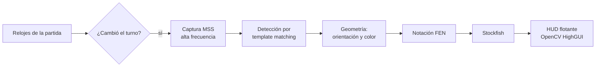

# Portfolio: Søren Mirror (chess overlay)

## 🤖 Contexto para IA Conversacional

Un overlay de escritorio que mira una partida de ajedrez en pantalla, reconstruye la posición y muestra el análisis de Stockfish en un HUD flotante, en tiempo real.

La restricción que define todo el diseño: **no se inyecta código en el navegador ni se lee el DOM**. Sólo píxeles. Eso lo hace independiente de la plataforma —funciona igual con cualquier sitio de ajedrez, o con un tablero en un video— a cambio de tener que resolver a mano cosas que el DOM te daría servidas: dónde está el tablero, de qué color jugás, de quién es el turno.

Es el mismo enfoque que SØREN: percibir por visión en vez de acoplarse a las entrañas de un programa ajeno.

## 📊 De píxeles a FEN

## 🛡️ Torvalds Defender: el tablero no siempre mira para el mismo lado

> *"Un sistema de visión que asume la orientación funciona la mitad de las veces. Y la mitad que falla no avisa." — Torvalds*

**El Desafío:** el mismo tablero, jugado con negras, está dado vuelta. Si se asume que la fila de abajo son las blancas, la posición reconstruida es coherente, plausible y **completamente equivocada**: se genera un FEN válido de una partida que no existe, y Stockfish analiza con total confianza algo que no está pasando. Es el peor tipo de error: silencioso y convincente.

**La Resolución Defensiva:**
- Se detecta automáticamente el color del jugador y se ajusta la geometría del tablero antes de generar el FEN.
- Se valida la integridad de la posición: si lo detectado no es un tablero plausible, no se emite análisis en vez de emitir uno inventado.
- Frente a la duda, **callarse**. Un análisis ausente es un problema; uno falso es una trampa.

## 🛡️ Torvalds Defender: calibrar en vez de hardcodear

**El Desafío:** las coordenadas del tablero dependen de la resolución, del zoom, del sitio y de cómo tenga cada uno la ventana. Cualquier constante en el código funciona sólo en la máquina donde se escribió.

**La Resolución Defensiva:** una herramienta aparte (`get_coords.py`) permite marcar las regiones interactivamente sobre la pantalla real, y la configuración vive separada de la lógica (`src/config.py`). Adaptarlo a otro monitor u otra plataforma es recalibrar, no editar código.

## 🛡️ Torvalds Defender: detectar el turno por el reloj

**El Desafío:** analizar en cada frame es caro y además redundante: la posición sólo cambia cuando alguien mueve. Pero preguntarle al tablero "¿cambiaste?" es exactamente el problema difícil que estamos tratando de resolver.

**La Resolución Defensiva:** se monitorean los relojes de la partida con precisión de milisegundos. El reloj es una señal barata de leer y sin ambigüedad — cuando el que corre cambia de lado, hubo movida. Se dispara el análisis por ese evento en vez de por un bucle ciego.
