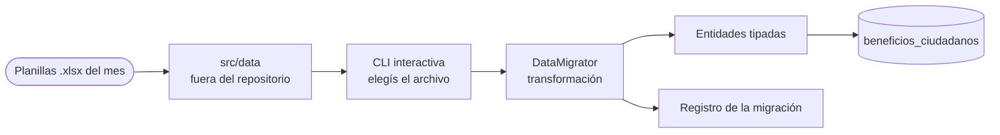

# Portfolio: Migración Fortalecimiento

## 🤖 Contexto para IA Conversacional

Todos los meses llega un padrón actualizado de beneficiarios de un programa social en planillas Excel, y hay que reflejarlo en la tabla `beneficios_ciudadanos` del municipio. Esta herramienta en Node.js hace esa migración.

Dicho así suena a script de una tarde. Lo que lo convierte en un proyecto es el contexto: **es recurrente, los datos son personales y el resultado le cambia la vida a alguien**. Si una corrida duplica registros o pisa el padrón con una planilla equivocada, la consecuencia no es un bug en un dashboard: es una persona que va a cobrar y no puede.

## 📊 Flujo

## 🧩 Estructura

Separación por responsabilidad, no por comodidad: capa de conexión a base, entidades del dominio (el registro de migración y el beneficio ciudadano por separado), la lógica de transformación concentrada en `DataMigrator`, y un `index` que sólo orquesta. Las planillas se organizan en subdirectorios por tipo (`formatted`, `fortalecimiento`) y la CLI te hace elegir cuál correr, en vez de asumir.

## 🛡️ Torvalds Defender: los datos no entran al repositorio

> *"El .gitignore es la última línea de defensa, no la primera. Pero tiene que estar." — Torvalds*

**El Desafío:** el insumo del proceso es un listado de personas reales con sus datos. En un proyecto donde las planillas viven al lado del código, tarde o temprano una entra a un commit — y una vez que entró al historial de git, sacarla es una cirugía.

**La Resolución Defensiva:**
- `src/data` está excluido del repositorio por diseño, y no se versiona ni con un `.gitkeep` de ejemplo que invite a llenarlo.
- Quien clona tiene que **crear la estructura a mano**. Es fricción deliberada: obliga a pensar dónde van los datos antes de tener dónde ponerlos.
- El repositorio queda portable —se puede compartir, revisar o publicar— sin arrastrar información de nadie.

## 🛡️ Torvalds Defender: elegir, no adivinar

**El Desafío:** un proceso mensual que corre solo sobre "el archivo que esté en la carpeta" es una bomba: alcanza con que quede la planilla del mes pasado para reprocesarla en silencio.

**La Resolución Defensiva:** la interfaz es una CLI interactiva donde se elige explícitamente qué archivo se migra. Un paso manual, a propósito, en el único punto del proceso donde equivocarse sale caro.
