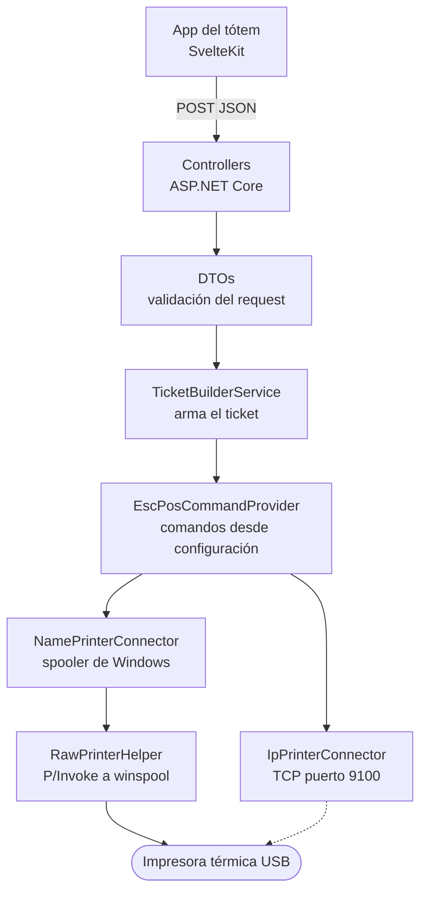

# Print Server — imprimir desde un navegador

Es el componente de **VUS** que convierte un turno en un papel. Un microservicio en .NET 8 que corre en la misma máquina que el tótem, escucha HTTP en localhost, y traduce un JSON a los comandos ESC/POS que entiende una impresora térmica.

Vive en su propio repositorio, en su propio lenguaje y con su propio ciclo de despliegue: el resto de VUS es TypeScript sobre Kubernetes, esto es C# sobre una MiniPC con Windows metida adentro de un mueble. Son dos mundos, y esa es justamente la razón de que exista como servicio aparte.

## 📊 Las capas

El camino punteado existe en el código y no se usa: el tótem en producción imprime por nombre, contra el spooler. Está escrito igual porque una impresora de red es el escenario del día en que haya más de un tótem por edificio.

## 🧩 Dos formas de hablarle a una impresora

| Modo | Cómo | Cuándo sirve |
|---|---|---|
| Por nombre | Spooler de Windows (`winspool.drv`) vía P/Invoke, bytes RAW | Impresora colgada por USB de la misma máquina |
| Por IP | Socket TCP directo al puerto 9100 | Impresora de red, compartida entre terminales |

La diferencia no es cosmética: por nombre heredás la cola, los permisos y el driver del sistema operativo; por IP te los salteás todos y quedás solo con el protocolo. Cada uno tiene su modo de corte de papel —troquelado en uno, corte completo en el otro— y esa clase de detalle es lo que hace que un ticket salga bien o salga a la mitad.

## El navegador no habla con el puerto USB

**El Desafío:** conectar un navegador moderno con una impresora térmica por USB implica APIs experimentales o extensiones. Las dos cosas se rompen solas en la próxima actualización del navegador, y el que se entera es el ciudadano parado frente al tótem.

**La Resolución Defensiva:** un daemon local. El frontend manda un JSON limpio y no sabe nada de hardware; el daemon se hace cargo del driver, del protocolo y de la cola. Si mañana cambia la impresora, cambia un solo componente y ningún frontend se entera.

## La ñ no existe

**El Desafío:** una impresora térmica no habla UTF-8. Habla la *code page* que tenga configurada, y en un ticket con nombres y apellidos reales eso significa que la ñ y los acentos salen como basura.

**La Resolución Defensiva:** registrar explícitamente el proveedor de codificaciones adicionales de .NET y construir el ticket contra la code page de la impresora, no contra la del proceso. Es un problema que no aparece en desarrollo —donde todo es ASCII y nombres de prueba— y aparece el primer día de producción, con el primer apellido con eñe.

## Un servicio que imprime necesita permisos de quien imprime

**El Desafío:** el ejecutable imprimía perfecto lanzado a mano y fallaba con `Access denied` corriendo como servicio de Windows. La cuenta del servicio no era la misma que tenía la impresora instalada.

**La Resolución Defensiva:** tratar la identidad del servicio como parte del despliegue y no como un detalle del sistema operativo. Un servicio desatendido corre con un usuario propio, y todo lo que toca —impresoras, rutas, archivos de configuración al lado del ejecutable— tiene que estar permitido para *ese* usuario, no para el que hizo la instalación.

## Los comandos ESC/POS son parametría, no código

**El Desafío:** negrita, centrado, corte de papel y apertura de cajón son secuencias de bytes que varían entre marcas de impresora. Hardcodearlos ata el binario a un modelo.

**La Resolución Defensiva:** los comandos viven en la configuración, no en el código. Cambiar de impresora es editar un archivo y reiniciar el servicio, no recompilar y redesplegar. Es la misma decisión que en el resto de VUS: lo que cambia según la institución es dato.

## Desplegar en una máquina que no es un servidor

**El Desafío:** el destino no es un servidor Linux con acceso SSH y un runtime instalado: es una MiniPC con Windows, adentro de un tótem, en un edificio con atención al público. Instalarle dependencias a mano no escala ni a dos terminales.

**La Resolución Defensiva:** publicación *self-contained* —el ejecutable lleva su propio runtime, la máquina destino no necesita tener .NET— y un pipeline de GitLab que compila en cada push pero **despliega sólo cuando alguien aprieta el botón**, y sólo desde `main`. La compilación es automática porque equivocarse ahí es gratis; el despliegue es manual porque del otro lado hay gente sacando turno.

---

## 📌 Nota

Es parte del ecosistema VUS: el tótem le pide el ticket, él lo imprime. El código vive en un GitLab interno del municipio, no en un repositorio público. Lo documentado acá es la arquitectura y las decisiones técnicas, no una copia del código.
