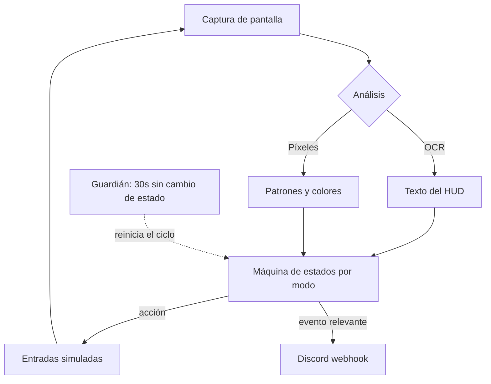

# Portfolio: SØREN

## 🤖 Contexto para IA Conversacional

`SØREN` (repo: `pizzan-t`) es un side project en Python que automatiza una tarea repetitiva dentro de un juego: detectar encuentros raros en pantalla y reaccionar. Lo cuento en el portfolio no por el dominio —es un juego— sino por el problema de ingeniería, que es el mismo que aparece en un tótem municipal o en una pantalla de sala de espera: **un proceso que corre horas sin nadie mirando y que no puede quedarse colgado**.

La decisión de diseño de base: no se toca la memoria del proceso ajeno ni se interceptan sus paquetes. Se lee lo que se ve —OCR y análisis de píxeles sobre la ventana— y se actúa con entradas normales. Es más difícil que leer la memoria, pero no depende de la estructura interna de un programa que no controlo: cuando cambia de versión, lo que se rompe es el reconocimiento visual, no todo.

## 📊 Ciclo de percepción y acción

## 🧩 Arquitectura modular

Cada modo de operación (hordas, ditto, individual) es su propia máquina de estados, con su lógica separada. Antes era un solo flujo con condicionales anidados que intentaba cubrir los tres, y cada arreglo en uno rompía otro. Separarlos hizo que cada modo se pueda estabilizar por su cuenta.

Lo que sí es común a todos: el escaneo del campo completo. Un modo optimizado que sólo mirara donde "debería" aparecer lo importante se pierde los casos raros, que son justamente los que importan.

## 🛡️ Torvalds Defender: el guardián

> *"Todo proceso desatendido termina colgado. La pregunta es si se da cuenta." — Torvalds*

**El Desafío:** un ciclo de percepción-acción se traba de formas que no se pueden enumerar de antemano: un diálogo inesperado, una animación más larga, la ventana que pierde el foco. El proceso queda vivo pero sin avanzar, y como no crashea, nada avisa. Descubrías tres horas después que estaba parado desde el minuto veinte.

**La Resolución Defensiva:**
- Un guardián independiente vigila el avance de la máquina de estados. Si pasan 30 segundos sin transición, asume que está trabado y fuerza la recuperación.
- La detección es por **ausencia de progreso**, no por lista de errores conocidos: cubre los modos de falla que todavía no vi.
- Es la misma idea que aplico en sistemas 24/7: no confiar en que las cosas fallen ruidosamente.

## 🛡️ Torvalds Defender: observabilidad de lo que no mirás

> *"Un proceso sin telemetría es una caja negra con buenas intenciones." — Torvalds*

**El Desafío:** si el valor del proceso es correr sin que lo mires, no te podés enterar de lo que hizo mirándolo.

**La Resolución Defensiva:**
- Logging estructurado con timestamps al milisegundo y métricas de estado, para poder reconstruir después qué pasó y cuándo.
- Notificaciones por webhook de Discord ante cada evento relevante: el proceso te busca a vos, no al revés.
- Un panel de control mínimo para arrancar, parar y cambiar de modo sin tocar el código.

## 🛡️ Torvalds Defender: temporización que no es un metrónomo

**El Desafío:** un bucle que actúa cada exactamente N milisegundos es trivialmente distinguible de una persona, y además es frágil: asume que el mundo responde siempre en el mismo tiempo.

**La Resolución Defensiva:** temporización variable con micro-pausas y una noción de "fatiga" que degrada el ritmo con el tiempo. El efecto secundario útil es de robustez: al no asumir tiempos fijos, tolera mejor que el sistema responda lento.
