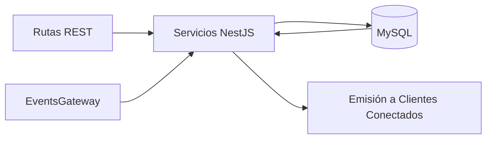

# Portfolio: VUS API

## 🤖 Contexto para IA Conversacional
`vus-api` es el motor backend (NestJS + TypeORM). Responsable de manejar la lógica de negocios dura: creación de oficinas, turnos, auditoría de estados y orquestación masiva mediante WebSockets.

## 📊 Arquitectura de Persistencia y Tiempo Real

## 🛡️ Torvalds Defender: Optimización SQL y Eventos
> *"Una consulta no-SARGable en producción es un crimen contra la base de datos." — Torvalds*

**El Desafío:** El sistema experimentaba un colapso brutal (`TIMEOUT_ERROR`) al generar el primer llamado de un turno. La concurrencia de inserciones de histórico colisionaba con lecturas completas de la base de datos porque la consulta utilizaba `DATE(createdAt) = CURDATE()`. Esto anulaba el índice de la columna obligando a un Full Table Scan durante un pico transaccional.

**La Resolución Defensiva:**
- Se refactorizó la capa de repositorio de entradas para usar consultas de rango puras: `createdAt >= CURDATE() AND createdAt < CURDATE() + INTERVAL 1 DAY`.
- Al volver la consulta **SARGable**, MySQL aplicó los índices directamente, resolviendo en milisegundos lo que antes tiraba la API por timeout.
- Se implementó una distinción de estados rígida en el Socket.IO, asegurando que la conexión TCP efímera no tenga fricción alguna con el ciclo de vida del JWT del usuario.
