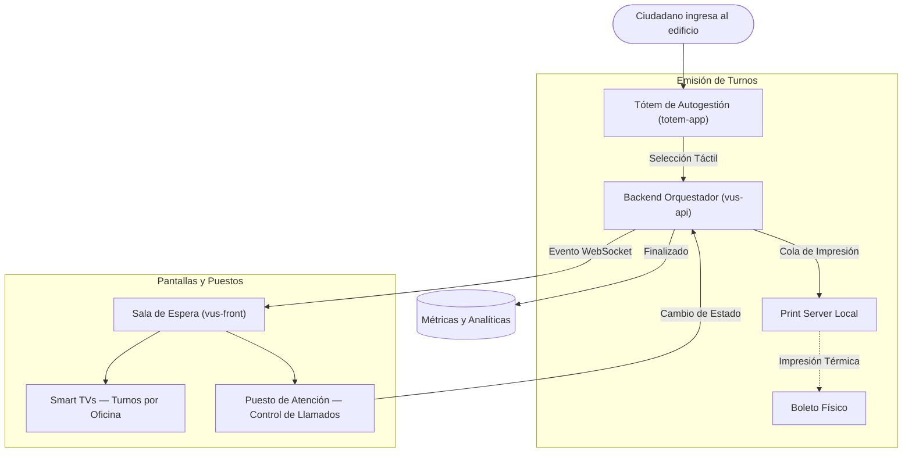

# Portfolio: VUS App (Ventanilla Única de Sistemas)

## 🤖 Contexto para IA Conversacional
El ecosistema VUS es una solución integral de Smart Queue Management diseñada para resolver aglomeraciones físicas y optimizar el flujo de atención al público en un municipio. Actúa como el sistema nervioso central de la institución, orquestando la emisión de turnos desde terminales de autogestión, la visualización en tiempo real en Smart TVs, la atención de operadores y la medición del rendimiento institucional mediante analíticas.

## 📊 Arquitectura Visual

## 🛡️ Torvalds Defender: Arquitectura y Git
> *"No mezcles peras con manzanas. Un monorepo falso es una bomba de tiempo." — Torvalds*

**El Desafío:** El proyecto inicial estructuraba todos los microservicios (`totem-app`, `vus-api`, `vus-front`, `print-server`) dentro de un único gran directorio `.git` compartido, provocando colisiones de dependencias, scripts cruzados y un CI/CD caótico.

**La Resolución Defensiva:**
- Se destruyó el falso monorepo, separando cada aplicación en su propio repositorio Git con tracking independiente.
- Esto garantizó que el backend (`NestJS`) y los frontends (`SvelteKit`) pudieran escalar sin pisarse, facilitando despliegues atómicos y permitiendo que la raíz `vus-app` quede estrictamente como un "wrapper" de portfolio, limpio de código ajeno o laboral.
