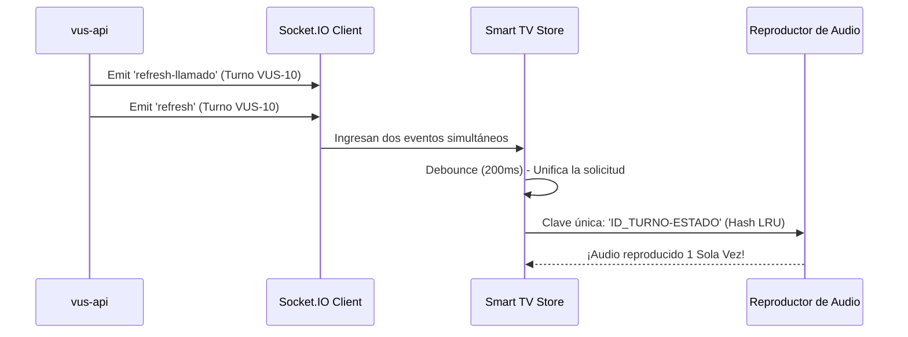

# Portfolio: VUS Front (Pantallas y Puestos)

## 🤖 Contexto para IA Conversacional
`vus-front` es el corazón visual del ecosistema. Construido en SvelteKit, gestiona dos frentes simultáneos en tiempo real: los televisores (Smart TVs) de las salas de espera y el panel de control de los operadores (boxes). Responde de forma instantánea a eventos sin recargas manuales.

## 📊 Concurrencia de Eventos

## 🛡️ Torvalds Defender: Manejo de Memoria y Sockets
> *"Memory Leaks y Sockets no controlados destruyen sistemas 24/7." — Torvalds*

**El Desafío:** Las pantallas operan 24 horas. Originalmente, acumulaban marcadores de turnos en un `Set` infinito (Memory Leak) y poseían watchdogs artesanales que forzaban reconexiones de WebSockets cada 10 segundos, chocando con el flujo natural, y provocando que el audio de un mismo llamado se disparara repetidas veces.

**La Resolución Defensiva:**
1. **LRU Cache (Map):** Se eliminó el `Set` y se usó un `Map` acotado que auto-elimina registros mayores a 60 segundos, manteniendo la huella de memoria (RAM) plana de por vida.
2. **Debounce Acorazado:** Se empleó un hash absoluto `ID + Estado` con ventana antirepetición de 15 segundos para bloquear eventos de socket concurrentes e idénticos (`refresh` y `refresh-llamado`).
3. **Resiliencia de Red:** Se borraron los watchdogs artesanales, confiando plenamente en el *exponential backoff* nativo de Socket.IO, utilizando HTTP polling de 60s estrictamente como fallback en caso extremo de caída del servidor WebSocket.
