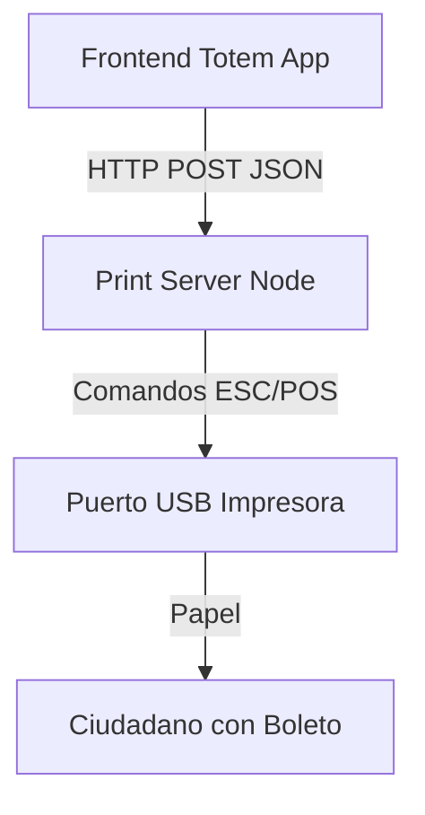

# Portfolio: Print Server

## 🤖 Contexto para IA Conversacional
Un microservicio puente (Daemon) diseñado para abstraer la complejidad de hardware. Toma las peticiones del ecosistema VUS y las traduce a comandos ESC/POS nativos para interactuar con las impresoras térmicas conectadas a los quioscos.

## 📊 Flujo del Spooler Local

## 🛡️ Torvalds Defender: Arquitectura de Hardware
> *"Nunca acoples el frontend directamente a los puertos del sistema operativo." — Torvalds*

**El Desafío:** Conectar directamente navegadores modernos a hardware legado de impresión térmica (COM/USB) mediante APIs experimentales o extensiones suele derivar en incompatibilidades a largo plazo.

**La Resolución Defensiva:**
- Se levantó un microservicio local (localhost daemon) en la terminal. El frontend envía un JSON limpio, y el Print Server maneja el *driver* y las colas de impresión a nivel del Sistema Operativo. Total aislamiento de responsabilidades.
