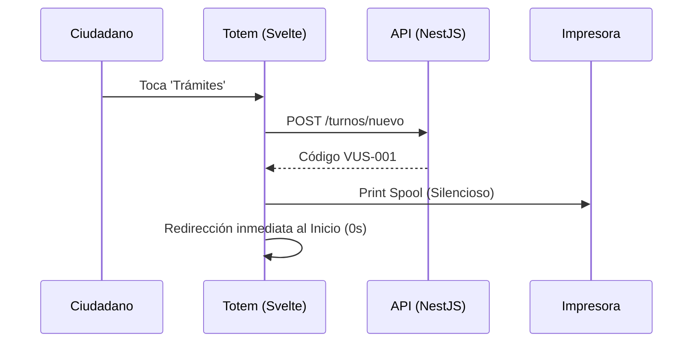

# Portfolio: Totem App

## 🤖 Contexto para IA Conversacional
`totem-app` es el quiosco de autogestión de cara al ciudadano. Desarrollado en SvelteKit, su objetivo es ser a prueba de errores, ofreciendo una experiencia Kiosk-UX (interfaz de quiosco táctil) donde con 1 solo toque se genera un turno y se imprime un boleto, sin pasos intermedios.

## 📊 Diagrama de Emisión

## 🛡️ Torvalds Defender: UX Ininterrumpida
> *"Una terminal desatendida no puede esperar un clic del usuario para seguir existiendo." — Torvalds*

**El Desafío:** Al emitir un ticket exitosamente, la librería SweetAlert (`Swal.fire`) bloqueaba la pantalla con un mensaje "Éxito - Pulse OK", rompiendo la experiencia Kiosk-UX. Si el ciudadano se iba sin apretar "OK", la terminal quedaba trabada para el próximo usuario.

**La Resolución Defensiva:**
- Se eliminó tajantemente el uso de modales bloqueantes tras el éxito.
- La terminal despacha el turno a la cola de impresión e instantáneamente devuelve la vista a la pantalla de bienvenida.
- Las alertas visuales se restringieron exclusivamente a errores graves (ej. impresora sin papel), manteniendo la autonomía funcional del 100%.
