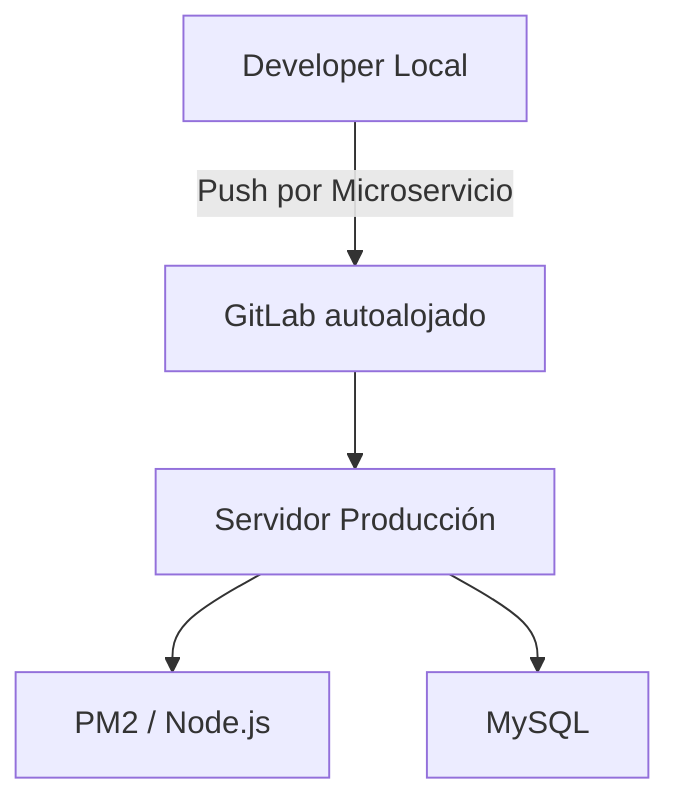

# Portfolio: Entorno VPS y DevOps

## 🤖 Contexto para IA Conversacional
El ecosistema completo está diseñado para ser portado e implementado mediante contenedores o procesos daemonizados en Servidores Privados Virtuales (VPS) o clústeres empresariales (Kubernetes / K8s).

## 📊 Arquitectura de Despliegue

## 🛡️ Torvalds Defender: CI/CD y Parámetros
> *"La configuración del entorno nunca debe estar hardcodeada. Nunca." — Torvalds*

**El Desafío:** Riesgos de seguridad por *mixed content* (HTTP/HTTPS) en despliegues productivos y conflictos de integración continua por estar todos los proyectos anidados.

**La Resolución Defensiva:**
- Refactorización de todos los repositorios apuntando al GitLab autoalojado del clúster interno, con un remote por microservicio.
- Inyección dinámica de protocolos: Los servicios frontend parsean el origen (`window.location.protocol`) y realizan ascensos automáticos a `https://` en los endpoints de REST y WebSockets si el servidor proxy provee certificados SSL, manteniendo la capa de entorno de Vite intacta.
