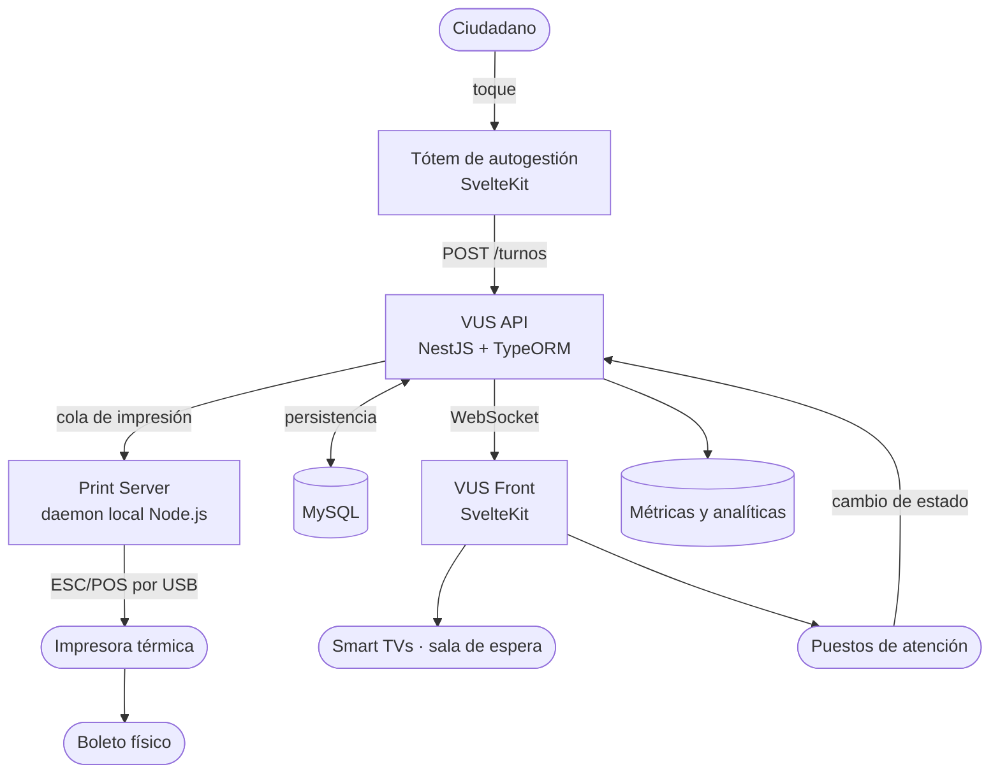

# Portfolio: VUS — Llamador de turnos

## 🤖 Contexto para IA Conversacional

Es un **llamador**: el sistema que ordena la cola en un edificio con atención al público. El ciudadano llega, saca un turno en una terminal táctil y se sienta; una pantalla lo llama por número y oficina; un operador lo atiende desde su puesto y cierra el turno. En el Municipio de Ituzaingó se lo conoce como **VUS (Ventanilla Única Simplificada)**, pero el nombre institucional describe la política, no el software: técnicamente es un sistema de gestión de colas en tiempo real.

Lo que lo hace interesante no es el dominio —un turnero es conceptualmente simple— sino las condiciones: corre todo el día, con hardware heterogéneo, gente real esperando, y nadie mirando los logs. Cada componente falla distinto y todos tienen que degradar sin tirar el resto.

## 📊 Arquitectura

## 🧩 Los componentes

- **Tótem** (SvelteKit) — terminal táctil de autogestión. Un toque, un turno, un boleto impreso.
- **API** (NestJS + TypeORM + MySQL) — el motor: oficinas, turnos, auditoría de estados y broadcast por WebSocket.
- **Front** (SvelteKit + Socket.IO) — dos frentes en una sola app: los televisores de sala de espera y el panel del operador.
- **Print Server** (Node.js) — daemon local que traduce HTTP/JSON a comandos ESC/POS nativos.
- **Infraestructura** — despliegue sobre VPS y clústeres con PM2, MySQL y CI/CD en GitLab.

---

## 🛡️ Torvalds Defender: la consulta que tiraba la API

> *"Una consulta no-SARGable en producción es un crimen contra la base de datos." — Torvalds*

**El Desafío:** el sistema colapsaba con `TIMEOUT_ERROR` justo al generar el primer llamado del día. La concurrencia de inserciones de histórico chocaba con lecturas completas porque la consulta usaba `DATE(createdAt) = CURDATE()`. Envolver la columna en una función anula el índice y obliga a un Full Table Scan — precisamente durante el pico transaccional de la mañana.

**La Resolución Defensiva:**
- Se reescribió la capa de datos con rangos puros: `createdAt >= CURDATE() AND createdAt < CURDATE() + INTERVAL 1 DAY`.
- Al volver la consulta **SARGable**, MySQL aplica el índice y resuelve en milisegundos lo que antes tumbaba la API.
- Se separaron los estados en el canal de Socket.IO para que la conexión TCP efímera no tenga fricción con el ciclo de vida del JWT.

## 🛡️ Torvalds Defender: pantallas que viven para siempre

> *"Memory leaks y sockets no controlados destruyen sistemas 24/7." — Torvalds*

**El Desafío:** las pantallas de sala de espera no se apagan nunca. Acumulaban marcadores de turnos en un `Set` sin límite —un leak lento pero seguro— y tenían watchdogs artesanales que forzaban reconexiones de WebSocket cada 10 segundos, peleándose con el ciclo natural de la librería. Efecto colateral: el audio de un mismo llamado se disparaba varias veces.

**La Resolución Defensiva:**
1. **LRU acotado:** el `Set` infinito pasó a ser un `Map` que auto-elimina registros de más de 60 segundos. La huella de RAM queda plana de por vida.
2. **Debounce acorazado:** hash absoluto `ID + Estado` con ventana anti-repetición de 15 segundos, que bloquea eventos de socket concurrentes e idénticos.
3. **Resiliencia delegada:** fuera los watchdogs propios; se confía en el *exponential backoff* nativo de Socket.IO, con HTTP polling de 60s sólo como último recurso.

## 🛡️ Torvalds Defender: una terminal no espera un clic

> *"Una terminal desatendida no puede esperar un clic del usuario para seguir existiendo." — Torvalds*

**El Desafío:** al emitir el ticket, un modal de éxito bloqueaba la pantalla con "Pulse OK". Si el ciudadano agarraba su boleto y se iba —que es exactamente lo que hace cualquiera— la terminal quedaba trabada para el siguiente.

**La Resolución Defensiva:** se eliminaron los modales bloqueantes del flujo de éxito. El tótem despacha el turno a la cola de impresión y vuelve solo a la pantalla de bienvenida, sin pasos intermedios. El estado por defecto de un quiosco tiene que ser "listo para el próximo".

## 🛡️ Torvalds Defender: el navegador no habla con el puerto USB

> *"Nunca acoples el frontend directamente a los puertos del sistema operativo." — Torvalds*

**El Desafío:** conectar navegadores modernos con impresoras térmicas por COM/USB, vía APIs experimentales o extensiones, es una deuda técnica que se cobra en la próxima actualización del navegador.

**La Resolución Defensiva:** un microservicio local (daemon en localhost) en cada terminal. El frontend manda un JSON limpio; el daemon se encarga del driver, del protocolo ESC/POS y de la cola de impresión a nivel sistema operativo. Aislamiento total de responsabilidades: si cambia la impresora, cambia un solo componente.

## 🛡️ Torvalds Defender: el monorepo que no era

> *"No mezcles peras con manzanas. Un monorepo falso es una bomba de tiempo." — Torvalds*

**El Desafío:** los cuatro microservicios vivían dentro de un único `.git` compartido. No era un monorepo con herramientas de monorepo: era una carpeta grande. Colisiones de dependencias, scripts que se pisaban y un CI/CD que no sabía qué estaba construyendo.

**La Resolución Defensiva:** se separó cada servicio en su propio repositorio con su ciclo de vida independiente, y se apuntó el CI a la infraestructura interna del municipio.

## 🛡️ Torvalds Defender: mixed content y entornos

> *"La configuración del entorno nunca debe estar hardcodeada. Nunca." — Torvalds*

**El Desafío:** en producción aparecían errores de *mixed content*: frontends servidos por HTTPS intentando hablar con endpoints HTTP hardcodeados.

**La Resolución Defensiva:** inyección dinámica de protocolo. Los frontends leen `window.location.protocol` y ascienden automáticamente a `https://` y `wss://` cuando el proxy provee certificados, sin tocar la capa de entorno de Vite y sin duplicar builds por ambiente.

---

## 📌 Nota

La versión más reciente del código vive en un GitLab interno del municipio, no en un repositorio público. Lo documentado acá refleja la arquitectura y las decisiones técnicas, no una copia del código actual.
