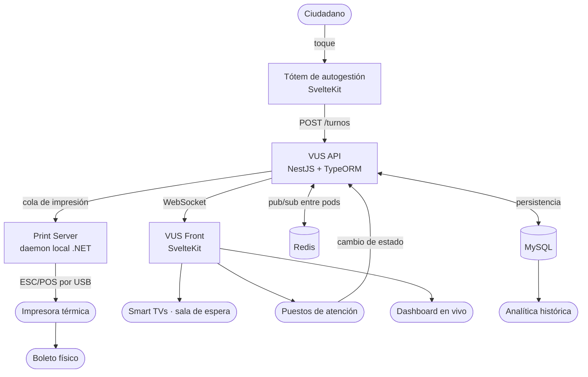
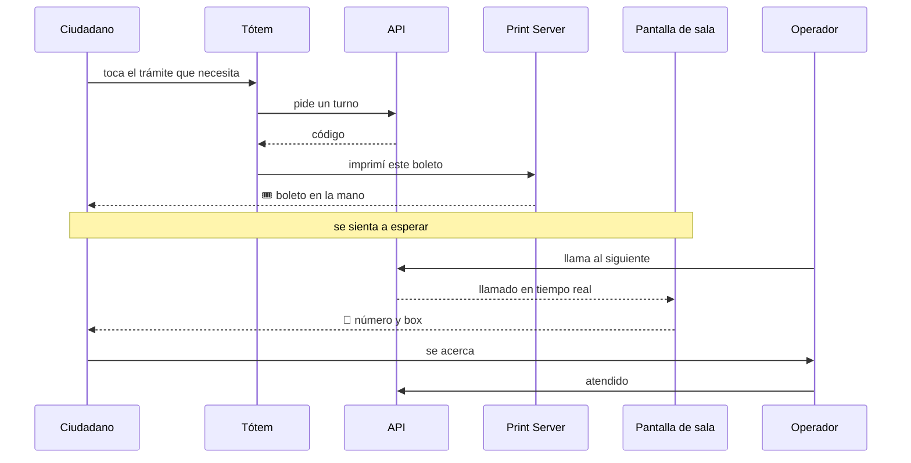
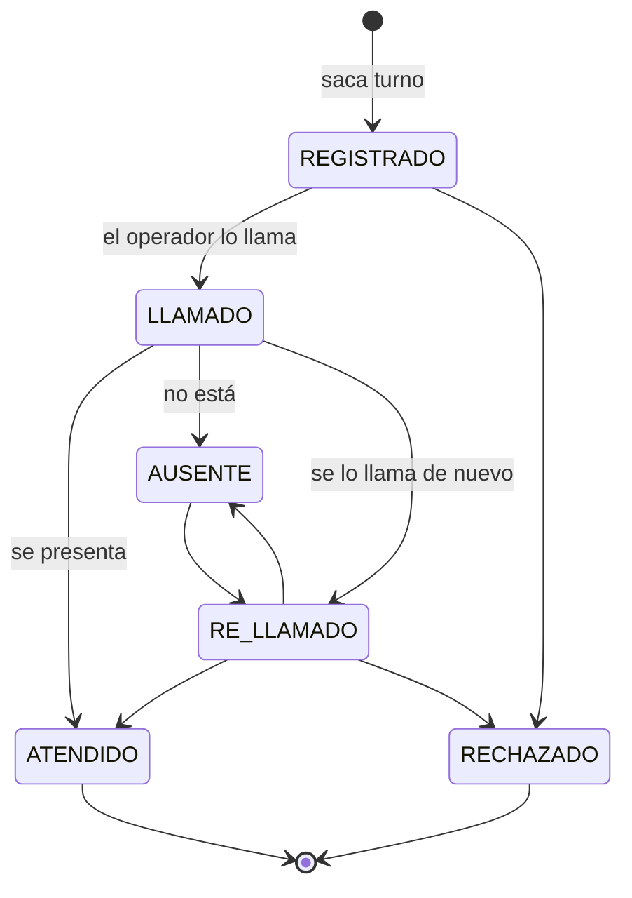

# VUS — Llamador de turnos

Es un **llamador**: el sistema que ordena la cola en un edificio con atención al público. El ciudadano llega, saca un turno en una terminal táctil y se sienta; una pantalla lo llama por número y oficina; un operador lo atiende desde su puesto y cierra el turno. En el Municipio de Ituzaingó se lo conoce como **VUS (Ventanilla Única Simplificada)**, pero el nombre institucional describe la política, no el software: técnicamente es un sistema de gestión de colas en tiempo real.

Lo que lo hace interesante no es el dominio —un turnero es conceptualmente simple— sino las condiciones: corre todo el día, con hardware heterogéneo, gente real esperando, y nadie mirando los logs. Cada componente falla distinto y todos tienen que degradar sin tirar el resto.

## 📊 Arquitectura

## 🎫 El recorrido de un turno

Todo el sistema existe para que esa secuencia no se corte en ningún punto. Cada flecha es un componente distinto, con una forma distinta de fallar.

## 🧩 Los componentes

- **Tótem** (SvelteKit) — terminal táctil de autogestión. Un toque, un turno, un boleto impreso.
- **API** (NestJS + TypeORM + MySQL) — el motor: oficinas, turnos, auditoría de estados y broadcast por WebSocket.
- **Front** (SvelteKit + adapter-node) — los televisores de sala de espera y el panel del operador, servido por Node con SSR y form actions. La sesión vive en cookies `httpOnly`; el hook del servidor decodifica el JWT, lo renueva solo cuando venció y reintenta una vez la request que se topó con un 401, así que al operador no se le corta el turno a la mitad por un token vencido.
- **Integraciones** — el sistema no es dueño de todos sus datos: los usuarios y los permisos vienen del servicio de autenticación central del municipio, y el padrón de ciudadanos de un servicio de catálogos. VUS referencia, no copia.
- **Dashboard** (Chart.js) — la foto del momento: qué está pasando **ahora** en el edificio. Se alimenta de los mismos eventos de socket que las pantallas, así que se mueve solo.
- **Analítica** (Chart.js) — lo contrario del dashboard: consulta histórica sobre datos ya cerrados. Tiempos de atención, volumen por oficina, comportamiento por franja horaria.
- **Print Server** (.NET / C#) — daemon local que traduce HTTP/JSON a comandos ESC/POS nativos. Tiene documentación propia: `cat ~/proyectos/print-server/README.md`.
- **Parametría** — oficinas, servicios y comportamiento del llamador se configuran desde el sistema, sin tocar código ni redeployar. Lo que cambia según la institución es dato, no build.
- **Infraestructura** — Kubernetes con múltiples pods, Redis, MySQL y CI/CD en GitLab.

## 🔁 El ciclo de vida de un turno

Un turno nace **registrado** en la cola de una oficina, pasa a **llamado** cuando un operador lo reclama a su box, puede volver a **re-llamarse** las veces que haga falta, y termina **atendido**. Si nunca aparece, queda como **no asistió**.

Sobre ese estado operativo corre un segundo eje, la **resolución**: si el turno está abierto, cerrado, o si se **derivó** a otra oficina. Son dos ejes y no uno porque responden preguntas distintas —"¿qué le está pasando ahora al ciudadano?" y "¿este trámite ya terminó?"— y confundirlos es la fuente de la mitad de los bugs que hubo que corregir.

La derivación es el caso interesante: cuando un trámite empieza en una oficina y sigue en otra, el turno original se cierra como derivado y nace una fila nueva en la oficina destino, apuntando a la original. Un mismo ciudadano, un mismo recorrido, dos filas trazables.

Dashboard y analítica comparten la librería de gráficos pero no el problema: uno tiene que reaccionar en milisegundos a un evento y el otro tiene que agregar meses de registros sin tumbar la base. Mezclarlos en una sola vista "que hace las dos cosas" hubiera terminado con consultas pesadas corriendo en tiempo real.

---

## La consulta que tiraba la API

**El Desafío:** el sistema colapsaba con `TIMEOUT_ERROR` justo al generar el primer llamado del día. La concurrencia de inserciones de histórico chocaba con lecturas completas porque la consulta usaba `DATE(createdAt) = CURDATE()`. Envolver la columna en una función anula el índice y obliga a un Full Table Scan — precisamente durante el pico transaccional de la mañana.

**La Resolución Defensiva:**
- Se reescribió la capa de datos con rangos puros: `createdAt >= CURDATE() AND createdAt < CURDATE() + INTERVAL 1 DAY`.
- Al volver la consulta **SARGable**, MySQL aplica el índice y resuelve en milisegundos lo que antes tumbaba la API.
- Se separaron los estados en el canal de Socket.IO para que la conexión TCP efímera no tenga fricción con el ciclo de vida del JWT.

## El llamado que se perdía entre pods

**El Desafío:** al pasar a Kubernetes con varias réplicas, los llamados empezaron a fallar de forma intermitente y desconcertante: un turno se llamaba y **algunas pantallas no se enteraban**. No era un error, no había excepción, no había nada en los logs.

La causa: Socket.IO mantiene las conexiones en la memoria del proceso. Con un solo pod eso alcanza. Con varios, cada uno conoce únicamente a los clientes conectados a él. Cuando un operador llamaba un turno y su request caía en el pod A, el evento se emitía sólo a los clientes de A — las pantallas conectadas al pod B se quedaban esperando algo que nunca iba a llegar. Y como el balanceador reparte, qué pantalla veía qué llamado dependía del azar.

**La Resolución Defensiva:**
- Se sumó **Redis como canal pub/sub entre pods**: cada instancia publica sus eventos y está suscrita a los del resto, así que emitir desde cualquier pod alcanza a todos los clientes, sin importar dónde estén conectados.
- El estado de las conexiones deja de vivir sólo en la memoria de un proceso: los pods pasan a ser realmente intercambiables, que es la premisa que Kubernetes asume y que el código no estaba cumpliendo.
- Es la lección de fondo: **escalar horizontal no es sólo levantar más réplicas**. Todo lo que estaba implícitamente en memoria —conexiones, sesiones, caché— hay que sacarlo afuera antes, o el sistema empieza a funcionar "a veces".

Con tres réplicas hay una **segunda** forma de romperse, independiente de la primera, y Redis no la arregla: antes de que exista el WebSocket, Socket.IO negocia la conexión con varias peticiones HTTP que tienen que caer **todas en la misma réplica**. Con el balanceador repartiendo, la segunda pega en un pod que no sabe nada de la primera y la conexión falla de a ratos, sin patrón.

La salida de manual era pedirle al área de redes afinidad de sesión en el balanceador. La que tomé no depende de nadie: **el cliente se conecta directo por WebSocket y se le saca la negociación por HTTP**. Antes de sacarla verifiqué que en la práctica ya elegía WebSocket igual — o sea que ese "fallback" no era una red de seguridad, era la única fuente del problema.

Y una decisión de la que estoy convencido: si Redis no responde o la URL está mal, **la API arranca igual** y lo avisa en el log. Antes no: un error de tipeo en una variable de entorno dejaba las tres réplicas sin levantar. Un tablero al que le falta un llamado se nota y se investiga; tres réplicas caídas es que no hay sistema. El precio es que degrada en silencio, así que el arranque dice explícitamente si el canal entre pods quedó activo: es la única señal que hay.

## Pantallas que viven para siempre

**El Desafío:** las pantallas de sala de espera no se apagan nunca. Acumulaban marcadores de turnos en un `Set` sin límite —un leak lento pero seguro— y tenían watchdogs artesanales que forzaban reconexiones de WebSocket cada 10 segundos, peleándose con el ciclo natural de la librería. Efecto colateral: el audio de un mismo llamado se disparaba varias veces.

**La Resolución Defensiva:**
1. **LRU acotado:** el `Set` infinito pasó a ser un `Map` que auto-elimina registros de más de 60 segundos. La huella de RAM queda plana de por vida.
2. **Debounce acorazado:** hash absoluto `ID + Estado` con ventana anti-repetición de 15 segundos, que bloquea eventos de socket concurrentes e idénticos.
3. **Resiliencia por capas:** la pantalla es lo único del sistema que nadie mira. Si se le cae la conexión, cada diez segundos intenta levantarla sola; y por si eso tampoco alcanza, cada treinta segundos vuelve a pedir los datos por HTTP como si no existiera el tiempo real. Nadie tiene que subirse a una escalera a reiniciar un televisor.

## Una terminal no espera un clic

**El Desafío:** al emitir el ticket, un modal de éxito bloqueaba la pantalla con "Pulse OK". Si el ciudadano agarraba su boleto y se iba —que es exactamente lo que hace cualquiera— la terminal quedaba trabada para el siguiente.

**La Resolución Defensiva:** se eliminaron los modales bloqueantes del flujo de éxito. El tótem despacha el turno a la cola de impresión y vuelve solo a la pantalla de bienvenida, sin pasos intermedios. El estado por defecto de un quiosco tiene que ser "listo para el próximo".

## El turno que nacía muerto

**El Desafío:** los turnos derivados llegaban rojos a la oficina destino. El clon que generaba la derivación nacía con el estado `1`, que en el diccionario del sistema no es "nuevo": es **NO ASISTIÓ**. El ciudadano estaba parado esperando en Tesorería y su turno figuraba como que nunca se presentó.

**La Resolución Defensiva:** el diccionario de estados pasó a ser explícito y compartido entre el backend y el frontend, y la derivación nace con el estado que corresponde a "en cola". El bug no era de lógica sino de vocabulario: dos capas usando el mismo número para decir cosas distintas.

## Un historial que mentía

**El Desafío:** cada vez que un operador volvía a llamar a un ciudadano, el historial del turno guardaba *"RESOLUCIÓN CONCLUIDA - ENTRADA CERRADA"*. La condición confundía el estado de **re-llamado** con un cierre, así que el registro de auditoría se llenaba de finalizaciones que nunca ocurrieron.

**La Resolución Defensiva:** los textos del historial se derivan del estado real, y el llamado y el re-llamado además guardan a qué puesto se llamó. De paso apareció el problema hermano: la derivación llamaba al método genérico de actualización, que registraba su propio avance, y cada derivación dejaba dos entradas en el historial. Se escribe directo contra el repositorio cuando el efecto secundario no corresponde.

## La campana que sonaba de más

**El Desafío:** las pantallas de sala de espera tocan un timbre cuando alguien es llamado. Cerrar administrativamente un turno cuyo último estado operativo había sido "llamado" re-emitía ese estado, y la sala escuchaba la campana por alguien a quien nadie estaba llamando. Gente levantándose de la silla por un cierre de planilla.

**La Resolución Defensiva:** se partió el evento en dos. Uno viaja cuando cambia el estado operativo —y ese es el único que escuchan las TVs— y otro cuando cambia sólo la resolución administrativa, que escuchan los paneles de operador. La cartelería pública dejó de enterarse de cosas que no le incumben.

Había una segunda causa, más sutil, para el mismo síntoma: reabrir un turno guardaba primero el cambio de estado y después la nota en el historial. Como el evento sale con el cambio de estado, la pantalla llegaba a leer el turno **antes** de que existiera la nota que le decía "esto es una reapertura, no suenes". Se invirtió el orden: primero la nota, después el estado. En una operación que dispara un evento, el orden en que escribís no es un detalle de estilo — es lo que decide qué ve el que escucha.

## Contar derivaciones cuando el dato es ambiguo

**El Desafío:** derivar y reabrir un turno dejaban exactamente la misma marca en la resolución. Contar derivaciones leyendo ese campo mezclaba las dos cosas, y las métricas del día salían infladas.

**La Resolución Defensiva:** una derivación se cuenta por lo único que la define sin ambigüedad: la fila nueva que apunta a su turno de origen. La métrica dejó de depender de un estado que puede cambiar después y pasó a depender de un hecho que ya ocurrió.

## El nombre del operador no vive en esta base

**El Desafío:** la tabla de puestos guardaba el nombre y el legajo del operador, copiados del sistema central de autenticación del municipio. En cuanto alguien cambiaba sus datos allá, acá quedaba la versión vieja, y en la pantalla del box aparecía el nombre de otro.

**La Resolución Defensiva:** el puesto guarda sólo la referencia al usuario; el nombre se resuelve contra el servicio que es dueño de ese dato. Una sola fuente de verdad, aunque cueste una consulta más. Los datos de otro sistema se referencian, no se copian.

## El tiempo real que se apagaba solo

**El Desafío:** las pantallas y los paneles dejaban de actualizarse sin ningún error, de a ratos, sin patrón. Eran **tres problemas distintos** que producían exactamente el mismo síntoma:

1. La conexión era una sola para toda la aplicación, pero cada pantalla la abría al entrar y **la cerraba al salir**. Un operador que pasaba de su puesto a atender un turno apagaba el tiempo real de todos, y nada volvía a encenderlo.
2. La pantalla de sala de espera no tiene usuario logueado. Cuando le llegaba un aviso e intentaba recargar sus datos, el cliente HTTP —pensado para pantallas con sesión— la mandaba al login. El aviso llegaba y los datos nunca se recargaban.
3. El tótem avisaba de cada turno nuevo, pero el servidor **no tenía a nadie escuchando ese aviso**. Socket.IO descarta en silencio lo que nadie declaró recibir: el mensaje salía, llegaba, y se tiraba a la basura.

**La Resolución Defensiva:** la conexión pasó a ser dueña del layout y no de cada pantalla —se abre una vez y vive mientras la aplicación viva—, se separó el camino de lectura pública del que exige sesión, y el servidor pasó a retransmitir explícitamente lo que le mandan los clientes. La lección de fondo es la primera: **el tiempo real no avisa cuando se rompe**. Hay que buscarlo, porque no aparece en ningún log.

## Tres segundos y me voy

**El Desafío:** la red interna de un edificio municipal tiene micro-cortes. Una petición al backend que quedaba esperando para siempre dejaba colgada la pantalla del operador —no lenta: colgada— porque del otro lado nadie iba a responder ni a cortar.

**La Resolución Defensiva:** toda petición se aborta a los tres segundos y devuelve un error que la interfaz sabe mostrar. Además el login limpia las cookies viejas al entrar, porque una sesión anterior a medio morir hacía fallar el ingreso sin explicar por qué, y deshabilita el botón mientras espera, para que una demora de red no se convierta en tres intentos de login simultáneos. Es preferible un error a los tres segundos que una pantalla que no vuelve nunca.

## El monorepo que no era

**El Desafío:** los cuatro microservicios vivían dentro de un único `.git` compartido. No era un monorepo con herramientas de monorepo: era una carpeta grande. Colisiones de dependencias, scripts que se pisaban y un CI/CD que no sabía qué estaba construyendo.

**La Resolución Defensiva:** se separó cada servicio en su propio repositorio con su ciclo de vida independiente, y se apuntó el CI a la infraestructura interna del municipio.

## Mixed content y entornos

**El Desafío:** en producción aparecían errores de *mixed content*: frontends servidos por HTTPS intentando hablar con endpoints HTTP hardcodeados.

**La Resolución Defensiva:** inyección dinámica de protocolo. Los frontends leen `window.location.protocol` y ascienden automáticamente a `https://` y `wss://` cuando el proxy provee certificados, sin tocar la capa de entorno de Vite y sin duplicar builds por ambiente.

---

## 📌 Nota

La versión más reciente del código vive en un GitLab interno del municipio, no en un repositorio público. Lo documentado acá refleja la arquitectura y las decisiones técnicas, no una copia del código actual.
